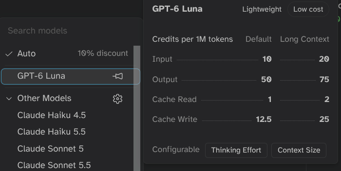
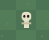
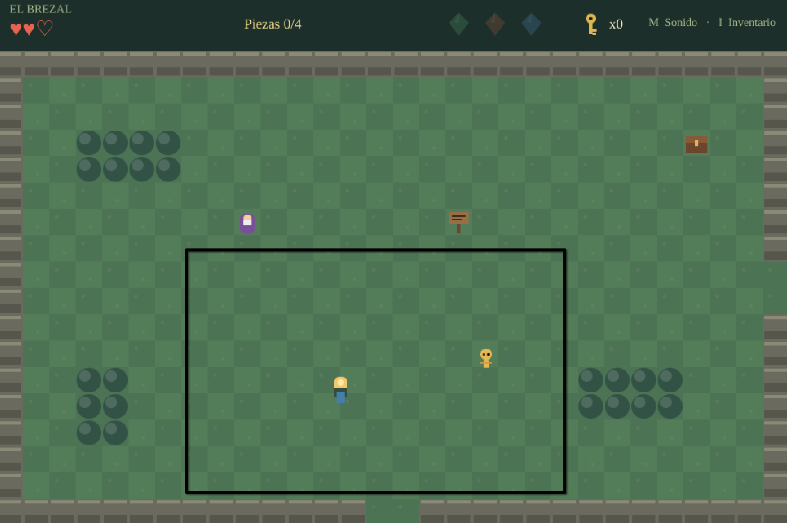
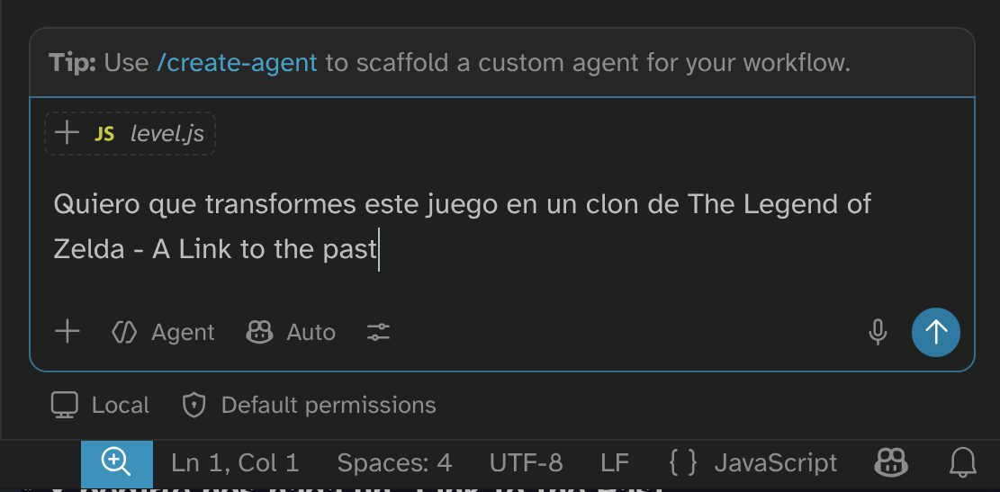
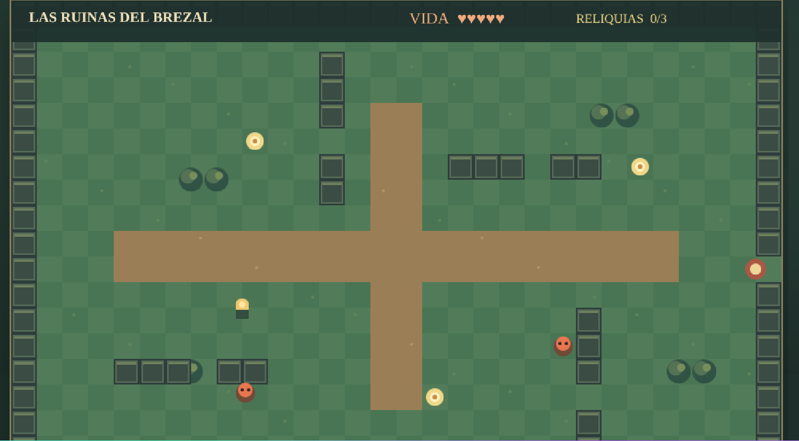

# -*- ispell-local-dictionary: "es"; encoding: utf-8; eval: (add-hook 'after-save-hook #'org-re-reveal-export-to-html nil t); compile-command: "npx vite --open" -*-
#+TITLE: Desarrollo de prototipos con IA
#+SUBTITLE: Máster de Videojuegos UCM
#+AUTHOR: Carlos León
#+email: cleon@ucm.es
#+LANGUAGE: es
#+OPTIONS:  toc:nil num:t timestamp:nil
#+REVEAL_ROOT: https://cdn.jsdelivr.net/npm/reveal.js
#+REVEAL_THEME: black
#+REVEAL_TRANS: slide
#+REVEAL_SPEED: fast
#+REVEAL_HLEVEL: 1
#+REVEAL_MARGIN: 0.02
#+REVEAL_MIN_SCALE: 0.2
#+REVEAL_GENERATE_IDS: t
#+REVEAL_MAX_SCALE: 1.2
#+REVEAL_PLUGINS: (notes highlight search zoom)
#+REVEAL_TITLE_SLIDE: <h1>%t</h1><h3>%a &lt;%e&gt;</h3><h4>%s</h4>
#+REVEAL_TITLE_SLIDE_EXTRA_ATTR: class="title-slide"
#+REVEAL_TOC_SLIDE_CLASS: toc-slide

#+BEGIN_EXPORT html

#+end_export

* Profesor
:PROPERTIES:
:UNNUMBERED: notoc
:END:

- Carlos León <[[mailto:cleon@ucm.es][cleon@ucm.es]]>
- Profesor FdI
- Docencia MVJ: Prototipado con IA, arquitectura UE, prácticas diseño de niveles, tutor de proyectos
- Investigación: Videojuegos, IA, Creatividad Computacional y Sistemas Cognitivos
- [[http://nil.fdi.ucm.es][Grupo de investigación NIL]]
- Despacho 444 FdI

* Índice
:PROPERTIES:
:UNNUMBERED: notoc
:END:

#+REVEAL_TOC: headlines 1

* Herramientas de IA (I)

** Objetivo de este módulo

Poder *diseñar juegos* y probarlos sin necesidad de programar los prototipos

** Objetivo de hoy

Entender cómo funciona una IA y empezar a usar agentes

** Qué vamos a conseguir

- Entender cómo funciona una IA generativa de código
- Conocer las herramientas necesarias
- Aprender a hacer /vibe coding/
- Transformar un GDD en un juego *sin programar* (aquí vamos a "sustituir" /al programador/)
- Pulirlo y adaptarlo hasta que represente *vuestra idea*
- Poder jugar a vuestro juego en navegador, escritorio o móvil*
- Publicarlo y compartirlo fácilmente para que se pueda jugar con una URL

#+BEGIN_EXPORT html

*No lo montaremos en móvil aquí, pero se puede</small>
#+END_EXPORT

** "No quiero IA"... Hablemos

- Vamos a conocer los modelos generativos y a entenderlos
- Una formación completa hoy en día requiere que conozcáis cómo usar la IA
- Veréis muy rápido que *no sustituyen a un equipo humano*
- Pero hacer cosas para tirar en diseño con modelos generativos es una herramienta muy útil

** ¿Hasta dónde llega la IA?

La IA no va a hacer un buen juego de verdad

El reto creativo ahora es mayor: *hacer juegos que la IA no pueda hacer*

** Cómo funciona una IA

*** 

- ¡Hola! ¿Cómo estás?
- Muy bien, ¿y ...
  #+ATTR_REVEAL: :frag (appear appear appear appear)
  - ... tú?
  - ... vosotros?
  - ... tu hermano?
  - ... /ensalada de tomate/ ?

*** 

¿Cómo *predecimos* las siguientes palabras?

*** ¿Cómo *entiende* el lenguaje un ordenador?

- 8739874 18739874
- 084098091 170980470  09280948098 28 9409808 ...
  #+ATTR_REVEAL: :frag (appear appear appear appear)
  - ... 09802984098?
  - ... 09820349809?
  - ... 0917987398 98579871?
  - ... 7138712987 581978 94 9871987?

*** 

#+begin_center
¿Cómo puede predecir un ordenador?
#+end_center

*** 
#+CAPTION: ¡Es todo *estadística*!
#+ATTR_HTML: :width 50%
[[file:2026-02-06_10-10-48_screenshot_pre.png]]

*** 

#+CAPTION: Pero le llamamos *aprendizaje máquina*
#+ATTR_HTML: :width 50%
[[file:2026-02-06_10-10-48_screenshot.png]]

*** 

#+CAPTION: Y son modelos *complejos*
#+ATTR_HTML: :width 80%
[[file:2026-02-06_10-28-58_screenshot.png]]

*** El 30 de noviembre de 2022

#+begin_center
¿Cómo se puede, con números, hacer ChatGPT?
#+end_center

*** Las ideas no son nuevas, ¿qué ha *cambiado*?

#+ATTR_REVEAL: :frag (appear appear appear)
- Capacidad de cómputo
- Modelos nuevos
- *Muchos datos*
  
  
*** Gran escala

- Varios meses de entrenamiento
- Decenas de millones de dólares
- Decenas de terabytes de información

  

*** 
#+begin_center
¿Pero por qué funciona *tan bien*?
#+end_center

***    

#+CAPTION: Arquitectura /Transformer/
#+ATTR_HTML: :width 30%
[[file:2026-02-06_11-01-55_screenshot.png]]

*** 
#+begin_center
Analiza *todas las palabras a la vez*, no una por una
#+end_center

*** 
#+begin_center
Representa las palabras como vectores de números, y lo hace analizando muchísimas frases ya escritas por personas
#+end_center

*** Ejemplos de encoding

#+begin_src python
"El perro corre" =
    [ 0.21, -0.34, 0.89, 1.12, -0.56, 0.04, ... ]
    
"El gato corre" =
   [ 0.24, -0.31, 0.85, 1.08, -0.52, 0.06, ... ]
#+end_src

*** Espacio latente = "mundo interno" donde la IA piensa

- Cada conjunto de números es un *concepto*
- Las palabras que solemos usar de forma relacionada están *cerca*

*** Generar  

#+begin_center
Con esto, ya solo nos queda *predecir*, con estadística, la próxima palabra más probable
#+end_center

*** Hasta aquí

- Tenemos mucho texto escrito por humanos (Internet)
- Analizamos las palabras y les asignamos números cercanos si las palabras aparecen relacionadas
- Cuando tenemos unas pocas palabras escritas, ya podemos predecir la siguiente, y *repetimos*

*** 

#+begin_center
ChatGPT no *sabe* nada \\
#+ATTR_REVEAL: :frag appear
No *piensa*\\
#+ATTR_REVEAL: :frag appear
No *entiende*
#+end_center

#+begin_center
#+ATTR_REVEAL: :frag appear
Solo *predice la próxima palabra más razonable*
#+end_center

*** Conclusión

- La IA moderna no es magia, ni un modelo humano: es *estadística*
- Usar cantidad casi infinita de *ejemplos* ha hecho posible que se parezca a lo que hacemos los humanos
- Hay mucha IA /diferente/ que se sigue usando
  

** Funcionamiento y memoria en un LLM

*** ¿Qué ocurre cuando hablamos con un LLM?

#+begin_center
Prompt \\
↓ \\
Tokenización \\
↓ \\
Modelo \\
↓ \\
Predicción de tokens \\
↓ \\
Respuesta
#+end_center

*** El modelo no empieza de cero

Un LLM ya ha sido entrenado antes de que nosotros lo utilicemos

Cuando escribimos un prompt normalmente no estamos esos parámetros (no está /aprendiendo/)

*** Entonces ¿cómo parece que se acuerda?

Porque el modelo puede recibir como entrada parte de la conversación anterior (se le da "todo el histórico" en cada petición)

*** El contexto tiene un límite

El modelo no puede recibir una cantidad infinita de información

Tiene una ventana de contexto y todo lo que entra en esa ventana compite por espacio

Cuando la conversación crece el sistema puede necesitar gestionar muchísimo contexto

Dependiendo de la herramienta puede *resumir conversaciones* anteriores, *eliminar información* o utilizar otros mecanismos para mantener la conversación dentro de los límites (por eso puede *olvidar cosas*)

*** ¿El modelo aprende cuando le corrijo?

No de la misma forma que cuando entrenamos (no se llama aprendizaje en este caso)

Si decimos:

#+begin_src text
> No quiero que utilices variables globales
#+end_src

el modelo puede utilizar esa información en las siguientes respuestas si sigue presente en el contexto

Pero no estamos modificando permanentemente el modelo para que todos sus futuros usuarios sepan que no queremos Singletons

*** Adaptarse no significa reentrenarse

Un LLM puede adaptar su respuesta al contexto:

- El tono
- El nivel de detalle
- El lenguaje
- Las restricciones
- El estilo de código
- Las decisiones de implementación
- Las prioridades

Pero sus parámetros (los "números" que lo definen) no van a cambiar
  
*** ¿Entonces el modelo "entiende"?

El modelo puede representar relaciones muy complejas entre conceptos, palabras, código y estructuras

Genera texto utilizando los patrones representados en sus parámetros y el contexto disponible

*** Por eso un agente de programación es diferente

Cuando utilizamos Copilot CLI no estamos hablando solamente con un modelo

Estamos usando herramientas que dan datos adicionales al prompt aunque no lo veamos

*** El agente puede ampliar el contexto

#+begin_src text
> Arregla el bug del inventario
#+end_src

El agente puede "decidir" añadir al contexto (porque el LLM lo genera así) archivos, resultados de ejecutar herramientas, logs...

*** Esto explica el vibe coding

Podemos describir una intención

#+begin_src text
  > Quiero que el enemigo persiga al jugador pero
  vuelva a su posición inicial cuando lo pierda de vista
#+end_src

El agente puede llamar a herramientas (=ls=, =grep=, =git=), añadir su salida al contexto, y volver a generar y llamar otra vez a herramientas

*** ¿Qué ocurre cuando empezamos un chat nuevo?

Empezamos *de 0*, ya no recuerda nada del contexto

*** ¿Y si una herramienta tiene memoria?

Hay herramientas que, al iniciar una sesión de agente, meten contexto predeterminado (y parece que "te conocen mejor"), pero es solo un proceso adicional:

- Preferencias
- Información del proyecto
- Resúmenes de conversaciones
- Instrucciones
- Datos de sesiones anteriores

*** Una buena analogía

- El programador ya tiene conocimientos generales de programación → Lo que ya sabe el LLM (porque se ha entrenado con código también)
- Le damos el README y el código del proyecto → Contexto

*** Por eso el contexto es una herramienta

Un buen vibe coder no solo sabe escribir prompts, sabe decidir qué información necesita el modelo (/archivos/, /restricciones/, /errores/, /resultados/...)

  #+begin_center
Poner *de más* puede llevar al modelo a alucinar o sobregeneralizar, poner *de menos* puede hacer que falte información relevante
  #+end_center

** System prompt, usuario y contexto

El /system prompt/ contiene instrucciones que establecen el comportamiento general del modelo para esa interacción

- Qué papel debe desempeñar
- Qué tipo de respuestas debe producir
- Qué reglas debe seguir
- Qué herramientas puede utilizar
- Qué restricciones tiene
- Qué formato debe utilizar
- Qué debe evitar

*** Simplificación: sistema + usuario

- =SYSTEM=: Cómo debe comportarse. En el bajo nivel, tiene unos tokens ocultos que le dan peso sobre la respuesta (por cómo está entrenado)
- =USER=: Qué queremos conseguir (nuestro prompt en cada iteración)

(En un agente real normalmente hay muchas más piezas)

*** El contexto

El contexto es toda la información disponible para generar una respuesta:

- System prompt
- Instrucciones de la aplicación
- Mensaje del usuario (/user prompt/)
- Mensajes anteriores
- Respuestas anteriores
- Código
- Documentación
- Resultados de comandos
- ...

*** El prompt no existe aislado

Meh...

#+begin_src text
> Hazlo más rápido
#+end_src

Mejor:

#+begin_src text
> Estamos haciendo un juego 2D en Godot
El enemigo tiene actualmente 200 agentes
El cálculo de pathfinding ocurre cada frame
Hazlo más rápido
#+end_src

*** El contexto puede crecer muy rápido

Una tarea puede producir muchísima información (pregunta + sistema + tools + output...)

Cada vuelta puede añadir información

*** Los modelos tienen una ventana de contexto limitada

No podemos proporcionar indefinidamente:

- Código
- Historial
- Logs
- Documentación
- Resultados de herramientas
- Respuestas anteriores

*** La ventana de contexto

Podemos imaginarla como una caja con capacidad limitada

Todo lo que queremos que el modelo tenga disponible debe caber dentro de esa ventana

*** ¿Qué ocurre cuando se llena?

El sistema necesita gestionar el contexto

Dependiendo de la herramienta puede

- Eliminar información antigua
- Resumir mensajes anteriores
- Recuperar información relevante
- Mantener instrucciones importantes
- Crear un nuevo contexto
- *Compactar* la conversación

*** Compactar no es recordar perfectamente

El resumen es una representación de la conversación anterior que no necesariamente contiene cada detalle

El objetivo es conservar suficiente información para continuar la tarea

*** El problema de los logs

Los logs son especialmente peligrosos para el contexto

Podemos hacer:

#+begin_src text
[agente]$ npm install
#+end_src

y obtener cientos o miles de líneas

#+REVEAL: split

Pero quizá solo necesitamos

#+begin_src text
ERROR: package X requires Node 22
#+end_src

Meter todo el log en el contexto puede consumir espacio sin aportar información útil

*** Una buena sesión de agente

Podemos estructurarla

1. Definir objetivo
2. Dar restricciones
3. Investigar código relevante
4. Implementar
5. Probar
6. Corregir
7. Validar

Cada etapa debería aportar información útil al contexto

*** Cuándo empezar una sesión nueva

Puede tener sentido empezar de nuevo cuando

- Hemos cambiado completamente de tarea
- El contexto contiene demasiado ruido
- El agente ha tomado una dirección equivocada
- Hay demasiados intentos fallidos
- La conversación se ha vuelto difícil de seguir
- Queremos proporcionar un contexto más limpio

*** Pero empezar de nuevo tiene un coste

Una sesión nueva no conoce automáticamente todas las decisiones anteriores

#+REVEAL: split

Por eso podemos preparar un resumen

#+begin_src text
OBJETIVO
ESTADO ACTUAL
DECISIONES
RESTRICCIONES
ARCHIVOS IMPORTANTES
PROBLEMAS CONOCIDOS
PRÓXIMO PASO
#+end_src

Y utilizarlo como contexto inicial

*** Contexto limpio vs contexto enorme

*** El código puede ser memoria

Una de las mejores formas de conservar decisiones técnicas es escribirlas en el propio proyecto

Por ejemplo

#+begin_src text
ARCHITECTURE.md

- El inventario utiliza InventoryComponent
- No utilizamos Singleton
- Los objetos implementan IItem
- El inventario tiene 20 huecos
#+end_src

*** Instrucciones persistentes

Algunas herramientas permiten definir instrucciones específicas para un proyecto

- Convenciones de código
- Arquitectura
- Comandos
- Restricciones
- Estilo
- Reglas del proyecto

*** La memoria ideal para un proyecto

Podemos imaginar varias capas

 #+begin_center
 REGLAS DEL PROYECTO \\
         ↓ \\
   DOCUMENTACIÓN \\
         ↓ \\
      CÓDIGO \\
         ↓ \\
CONTEXTO DE LA SESIÓN \\
         ↓ \\
   PROMPT ACTUAL
 #+end_center

Cada capa aporta información diferente

*** ¿Qué debería ir en cada capa?

Es positivo usar Markdown:

#+begin_src markdown
# REGLAS

"Usamos C#"
"No usamos Singleton"

# DOCUMENTACIÓN

"El sistema de inventario funciona así"

# CÓDIGO

Implementación real

# SESIÓN

"Ahora estamos arreglando RemoveItem()"

# PROMPT

"Corrige este error"
#+end_src

*** Contexto y coste

Más tokens de entrada pueden significar

- Más procesamiento
- Mayor consumo
- Mayor coste en sistemas basados en tokens
- Menos espacio disponible para la respuesta

Por eso gestionar el contexto es también una cuestión de eficiencia

*** Para vibe coding

- Compactar (=/compact=)
- Empezar una sesión nueva
- Recuperar documentación
- Reducir el contexto
- Dar de nuevo las restricciones importantes

** Herramientas de IA para generar

*** Webs con chat

- [[https://chatgpt.com/][ChatGPT]]
- [[https://claude.ai/][Claude]]
- [[https://gemini.google.com/][Gemini]]
- [[https://copilot.microsoft.com/][Microsoft Copilot]]
- [[https://www.perplexity.ai/][Perplexity]]
- [[https://grok.com/][Grok]]
- [[https://chat.mistral.ai/][Le Chat]]

*** Agentes de código

- [[https://claude.ai/code][Claude Code]]
- [[https://cursor.com/][Cursor]]
- [[https://openai.com/codex/][Codex]]
- [[https://github.com/features/copilot][GitHub Copilot]]
- [[https://antigravity.google/][Google Antigravity]]
- [[https://cline.bot/][Cline]]
- [[https://aider.chat/][Aider]]
- [[https://devin.ai/][Devin]]
 
*** Herramientas de completado

- [[https://github.com/features/copilot][GitHub Copilot]]
- [[https://cursor.com/][Cursor]]
- [[https://aws.amazon.com/codewhisperer/][Amazon Q Developer]]
- [[https://developers.google.com/gemini-code-assist][Gemini Code Assist]]
- [[https://devin.ai/desktop][Devin Desktop]]

*** Modelos generativos integrados de juegos

- [[https://labs.google/playground][Google Playground]]
- [[https://rosebud.ai/][Rosebud AI]]
- [[https://gdevelop.io/][GDevelop AI]]
- [[https://replit.com/usecases/ai-game-builder][Replit Game Builder]]
- [[https://www.summerengine.com/][Summer Engine]]
- [[https://phaser.io/][Phaser Game Agent]]
- [[https://create.roblox.com/docs/assistant/guide][Roblox Assistant]]
- [[https://www.buildbox.ai/][Buildbox]]

*** Visual Studio Code

Usaremos [[https://code.visualstudio.com/][VSCode]] y su integración con agentes

- Las últimas versiones vienen con Copilot ya integrado (con la cuenta de GitHub student lo tenéis)
- Antes se podía usar Gemini instalando su extensión:

[[file:clipboard-20261005T091436.png]]

[[file:clipboard-20261005T105513.png]]

(pero ahora hay que usar [[https://antigravity.google/][Antigravity]])

** Cuentas UCM para usar modelos

*** 

La cuenta de la UCM proporciona un cuenta da acceso a [[https://workspace.google.com/intl/es/?hl=es][Google Workspace]] y [[https://ssii.ucm.es/office-365-proplus-para-la-comunidad-universitaria-complutense][Microsoft 365]]: *tuusuario@ucm.es*

#+BEGIN_EXPORT html
<small style="display:block; margin-top:2em; color:#999;">
La disponibilidad concreta de cada servicio puede depender de la licencia
y de la configuración institucional
</small>
#+END_EXPORT

*** Microsoft Copilot 365

En [[https://portal.office.com/account][Microsoft 365 · Mi cuenta]] → ~Suscripciones~ puedes ver que tienes acceso a Copilot

Un vez ahí, entra en [[https://m365.cloud.microsoft/chat/?es=SSR][Copilot 365]] (integrado con los servicios de Office 365).

*** GitHub Copilot CLI

Si no tienes una cuenta de GitHub, [[https://github.com/signup][créala]]

Usa la dirección *tuusuario@ucm.es* para que sea de estudiante

*** Verifica que eres estudiante

Entra en:

[[https://github.com/settings/education/benefits][GitHub Education · Benefits]]

Pulsa en *=Start an application=*

Completa la verificación como estudiante.

Los estudiantes verificados obtienen acceso gratuito a
*GitHub Copilot Student*

*** Instala Copilot CLI

Necesitas [[https://nodejs.org/es][Node.js]]:

#+BEGIN_SRC sh
[usuario$/]$ npm install -g @github/copilot
#+END_SRC

o, si no tienes permisos de escritura como administrador (sin =-g=):

#+BEGIN_SRC sh
  [usuario$/proyecto/]$ npm init --yes
  [usuario$/proyecto]$ npm install @github/copilot
#+END_SRC

#+REVEAL: split

Después:

#+BEGIN_SRC sh
[usuario$/proyecto]$ copilot
#+END_SRC

Dentro de Copilot CLI, inicia sesión:

#+BEGIN_SRC text
/login
#+END_SRC

*** 

#+CAPTION: Copilot CLI
#+ATTR_HTML: :width 80%
[[file:clipboard-20261003T174213.png]]

*** Google Antigravity

Para usar los modelos de Google, hay que usar [[https://antigravity.google/][Google Antigravity]]

Hay que:

1. Bajarlo
2. Usar una cuenta personal (la UCM aún no da permisos)

*** 
Por dentro, Antigravity tiene el mismo editor que VSCode 
   

*** Devin

https://devin.ai/

*** Google AI Studio

https://aistudio.google.com/

*** ¿Qué modelo uso?

- *TODOS*
- Es posible mezclarlos, sacar lo mejor de cada uno
- Lo mejor para prototipar es usar los modelos más fuertes (y más "caros") primero para que la base de código sea robusta y hacer que modelos más baratos retoquen cosas

** Tokens, cuotas y costes

https://aistudio.google.com/rate-limit

#+CAPTION: Gestión de tokens en AI Studio de Google
#+ATTR_HTML: :width 50%
[[file:clipboard-20261005T134041.png]]

** llamafiles

Es posible ejecutar modelos de lenguaje en local (sin necesidad de usar un servicio externo)

Hay varias formas, una muy sencilla es con [[https://github.com/mozilla-ai/llamafile][llamafiles]]

Y hay [[https://docs.mozilla.ai/llamafile/getting-started/pre-built-llamafiles][muchos modelos]] disponibles

** Tareas

#+begin_center
Generar una aventura conversacional tipo Zork (con Gemini Antigravity, por ejemplo) sin tocar código
#+end_center

#+REVEAL: split

- Asegurarse de tener Node.js y un modelo (Copilot, Gemini...)
- Pedirle al modelo desde terminal que nos genere una aventura gráfica en modo texto en JavaScript y Node.js
- No vamos a "generar → salir → ejecutar → repetir", sino que vamos a hacerlo todo desde línea de comandos, incluso /ejecutar/ el juego
- Cuidado con los tokens, los costes, el modelo que usamos...
- Vamos generando versiones, comprobando código, revisando... un /diálogo/ con el sistema
  
* Herramientas de IA (II)

** Objetivo de hoy

Entender costes de la IA, saber gestionarlos

Elementos básicos para empezar a montar un diseño robusto escribiendo nuestras ideas

** Tokens

Un token es una pequeña pieza de texto que el modelo utiliza como unidad de procesamiento

El modelo no trabaja directamente con palabras como las vemos nosotros, sino con los tokens

#+begin_src text
  Palabras: "hola", "perro"
  Sufijos: "ito", "anti"
  Puntuación: ".", "?", " "
  Marcas: "#"
#+end_src

Dependiendo del idioma y la situación, podemos asumir entre un 25% y un 45% (aproximadamente) más de tokens que de palabras

** En código

La tokenización puede ser aún más agresiva:

#+begin_src python
  GetPlayerHealth()
#+end_src

Por eso no debemos "contar palabras" para estimar los tokens

** ¿Por qué nos importan los tokens?

Porque los servicios de IA utilizan los tokens para medir el uso

Normalmente distinguimos:

- Tokens de entrada → lo que enviamos al modelo
- Tokens de salida → lo que genera el modelo
- Tokens en caché → contexto que se reutiliza en determinados sistemas
- Tokens de razonamiento → tokens utilizados durante determinados procesos internos

** Entrada y salida

#+begin_src text
Haz que el jugador pueda hacer doble salto
#+end_src

El agente puede enviar además

- Nuestro prompt
- El código relevante
- Instrucciones del sistema
- Información de la conversación
- Resultados de herramientas
- Otros datos de contexto

  
** Los tokens también tienen un límite

Cada modelo (a través del agente) tienen una ventana de contexto /máxima/

La ventana de contexto limita cuánto puede tener en cuenta el modelo al mismo tiempo

** Tokens y dinero

Cuando utilizamos una API de pago, los tokens suelen ser una de las unidades utilizadas para calcular el precio

  #+begin_center
  Más tokens \\ 
      ↓ \\ 
  Más AIC \\ 
      ↓ \\ 
Más proceso       \\ 
      ↓ \\ 
  Mayor consumo \\ 
      ↓ \\ 
  Mayor coste
  #+end_center

** No todos los tokens cuestan lo mismo

Un modelo puede tener un precio determinado para:

- los tokens de entrada
- otro precio para los tokens de salida
- otro precio para los tokens almacenados en caché
- ...  

#+REVEAL: split

1.000.000 tokens ≠ 1.000.000 tokens de coste

** ¿Qué son los AI Credits?

GitHub utiliza los AI Credits como unidad para medir el uso de Copilot

Podemos pensarlo así

#+begin_center
Tokens \\
   ↓ \\
Precio del modelo \\
   ↓ \\
AI Credits \\
   ↓ \\
Dinero
#+end_center

#+REVEAL: split

El coste depende principalmente de

- El modelo utilizado
- La cantidad de tokens consumidos

Una interacción corta con un modelo ligero puede costar una fracción de AI Credit

Una sesión larga con un modelo avanzado puede consumir muchos más

#+REVEAL: split

Los planes de GitHub Copilot incluyen una cantidad mensual de AI Credits (recordad que tenemos algunos por la UCM/cuenta de estudiante)

** Cuando se acaban, podemos...

- Esperar al siguiente ciclo
- Cambiar de plan
- Configurar un presupuesto para uso adicional
- Seguir utilizando el servicio dentro de las condiciones disponibles

** Presupuesto de AI Credits

GitHub permite establecer un presupuesto para uso adicional ("meter" 10€ e ir gastándolos)

** AI Credits en Copilot CLI

- Podemos establecer un límite de AI Credits para una sesión
- El agente puede realizar varias operaciones durante una misma tarea
- Si alcanza ese límite, Copilot puede detener la sesión y pedirnos que ajustemos o restablezcamos el límite
- Los límites de sesión son una medida de control del gasto y pueden tener un pequeño margen respecto al límite configurado

  
#+REVEAL: split

#+CAPTION: El modelo importa (mucho)
#+ATTR_HTML: :width 50%

** El contexto importa para el coste

Hay que tener control de la ventana de contexto tanto por información *por cada coste de interacción*

#+REVEAL: split

- Scripts
- Escenas
- Configuración
- Shaders
- Logs
- Errores
- Documentación
- Assets y metadatos

#+REVEAL: split

Solución: controlar el contexto, decirle al agente lo que queremos que esté y lo que no

*Enfocar nuestra query* para contextos específicos

** JavaScript

- Menos configuración
- Más rápido para prototipos
- Fácil de empezar
- El agente puede escribirlo directamente

** TypeScript

- Tipos explícitos
- Mejor feedback del editor
- Refactors más seguros
- Contratos claros entre sistemas
- Más información disponible para el agente

** Puede ser muy estricto en los tipos

- A veces, de forma innecesaria, intentando corregir cosas que realmente funcionan
- Puede ser peligroso, pero decirlo que no sea estricto con los tipos puede ahorrar créditos de IA

** En general

La declaración de tipos vale como esquema para el LLM y de comprobación adicional para el agente

Arrancar y mantener un proyecto con TypeScript requiere más trabajo manual, pero lo hace el agente

TypeScript debería dar mejor código

Se pasan unos poquitos tokens más, pero suele ser más robusto

** Diffs

#+begin_src diff
 function attack() {
-  this.damage = 10
+  this.damage = 15
+  this.playAttackAnimation()
 }
#+end_src

- Las líneas con ~-~ han sido eliminadas
- Las líneas con ~+~ han sido añadidas
- Las líneas sin prefijo son contexto

** Están enfocados, /generalmente/, en líneas

#+begin_src diff
 function takeDamage(amount) {
-  this.health -= amount
+  this.health -= amount * 2
 }
#+end_src

** Leer un diff como diseñador

- ¿Qué archivos ha cambiado?
- ¿Qué ha añadido?
- ¿Qué ha eliminado?
- ¿Qué comportamiento puede cambiar?
- ¿Ha tocado algo que no le pedí?
- ¿Ha creado código nuevo cuando podía reutilizar código existente?

** Si no lo entendemos...

Se le puede preguntar al agente (aunque nos suele dar el resumen en cualquier caso)

#+REVEAL: split

#+begin_src text
  Resume únicamente los cambios de comportamiento

  No me expliques el código

  Quiero saber

  - Qué ha cambiado
  - Qué mecánicas cambiaron
  - Qué debería notar el jugador (dinámicas)
#+end_src

** Revisión antes de aplicación

Deberíamos *siempre* leer el diff y evaluar antes de aplicar

** Proceso de trabajo

- No pegar credenciales, tokens, datos personales ni material confidencial
- Revisar comandos antes de aprobarlos
- Trabajar en repositorios de práctica
- Usar /commits/ frecuentes y ramas para experimentos
- No publicar assets sin verificar licencia y atribución
- Si no entendemos un comando destructivo, mejor no lo ejecutamos

** Tres niveles de asistencia (compatibles)

- *Completado*: sugiere código mientras escribimos
- *Chat*: conversa sobre archivos y preguntas concretas
- *Agente*: reúne contexto, edita, ejecuta herramientas, valida e itera
- Cuanta más autonomía damos, más importantes son límites y revisión

** Modelo local

[[https://ollama.com/][ollama]] junto con un arnés (/harness/) como [[https://cline.bot/][Cline]] os puede valer para usar solo herramientas de código abierto

** Vigilar

- El proceso
- Lo que hace
- Mirar cada paso y corregir si es necesario
- Controlar contexto
- Ir cambiando de agentes
- *Estamos haciendo un prototipo, no un release*

** Playwright

https://playwright.dev/

Es un sistema que testing muy completo en tiempo real

Te "mira" el DOM y la pantalla para ver si todo está funcionando

Puede disparar el consumo, es mejor no activarlo para tests evidentes (mejor decirle al agente que algo "no ha funcionado")

** El rol del diseñador cambia

- De especificar pantallas a especificar *comportamientos*
- De entregar assets a diseñar un *pipeline* de integración
- No vale "hazlo más divertido": decidle qué mecánica cambia
- De esperar una implementación a explorar variantes rápidamente
- El criterio de diseño *gana valor*

** Riesgos que debemos nombrar

- Alucinaciones de API y versiones
- Dependencias innecesarias o vulnerables
- Cambios masivos difíciles de revisar
- Assets sin licencia o con estilo incoherente
- Sesgos, contenido no deseado y datos sensibles
- Deuda técnica invisible detrás de una demo convincente

** Refinar prompt general

Es muy útil tener archivos de texto con información general para prompts (y no estar copiando y pegando)

Cuando el LLM no esté haciendo lo que queramos, añadimos una frase con restricciones → si funciona, *lo agregamos al archivo*

** Tareas

#+begin_center
Comenzar con el concepto de juego, poder subir el proyecto, preparar el repositorio
#+end_center

#+REVEAL: split

- Entender mejor el proceso técnico y afianzarlo
- Entender costes y cuotas
- Ser capaces de usar chat (cuotas mucho más altas) y agentes distintos
- Conseguir (usando el agente) que se empaquete y sea distribuible

* Desarrollo en Phaser con IA (I)

** Objetivo de hoy

Conocer Phaser y desarrollo web

Montar y publicar lo primera versión del juego

** Phaser
*** ¿Qué es Phaser?

[[https://phaser.io/][Phaser]] es un framework para crear videojuegos 2D web

Utiliza JavaScript o TypeScript

*** Escritorio y móvil

Se puede jugar también exportando a escritorio o a móvil

Menos rendimiento que motor nativo, pero excelente para prototipar

*** ¿Por qué Phaser es interesante para vibe coding?

- Porque gran parte de lo que queremos construir está expresado como código relativamente directo
- Porque los agentes son excepcionales con JS/TS
- Porque hay muchísimo código escrito en abierto en Phaser
- Porque el loop de desarrollo es /inmediato/



*** Phaser tiene una API muy visible

Muchas acciones del juego tienen una correspondencia bastante clara con código

- Crear sprite → ~this.add.sprite(...)~
- Mover → ~player.x += ...~
- Animar → ~this.anims.play(...)~
- Sonido → ~this.sound.play(...)~
- Cambiar escena → ~this.scene.start(...)~

#+REVEAL: split

- Para vibe coding interesa trabajar con una tecnología que el modelo conozca bien
- Phaser utiliza JavaScript y TypeScript
- Tiene una API pública, documentación y una enorme cantidad de ejemplos
- La propia documentación de Phaser señala que su API está muy bien indexada por herramientas de IA

*** Phaser es especialmente bueno para prototipar

La IA puede encargarse de buena parte del trabajo mecánico

Mientras nosotros nos concentramos en

- Diseño
- Sensaciones
- Reglas
- Ritmo
- Feedback
- Balance
- Dirección artística

*** El navegador reduce la fricción

- Podemos enseñar un juego simplemente con una URL
- No hay que instalar casi nada
- El ciclo entre diseñar y probar es muy corto
 

*** Intro a arquitectura de videojuegos

(Si hace falta)

- Inicio y carga
- Bucle de juego (delta, repetición, estado)
- Elementos, herencia y componentes

*** Módulos de Phaser

#+begin_export html
<small>
#+end_export
- Renderizado
- Imágenes y sprites
- Animaciones
- Audio
- Input
- Física
- Cámaras
- Escenas
- Partículas
- Tweens
- Tilemaps
- Texto
- Gestión de assets
#+begin_export html
</small>
#+end_export

*** Arquitectura de Phaser

Cuando arrancamos Phaser creamos un Game:

#+begin_src typescript
  const config = {
  type: Phaser.AUTO,
  width: 960,
  height: 640,
  PARENT: 'juego',
  scale: {
    mode: Phaser.Scale.FIT,
    autoCenter: Phaser.Scale.CENTER_BOTH,
  },
  pixelArt: true,
  scene: [BootScene, WorldScene, DungeonScene, EndScene, UIScene],
  physics: {
    default: 'arcade',
    arcade: {
      gravity: { x: 0, y: 0 },
      debug: false,
    },
  },
};

new Phaser.Game(config);

#+end_src

*** Game Objects

- =Sprite=
- =Text=
- Jugador
- Enemigo
- Bala
- Moneda
- Botón
- Partícula

#+REVEAL: split

Un =GameObject= tiene propiedades y comportamiento y pertenece a una =Scene=

Podemos cambiar su posición, escala, rotación, visibilidad y otras características

*** Scenes

Contienen los objetos y son la base del main loop:

- Boot
- Main Menu
- Game
- Pause
- Shop
- Game Over

*** El ciclo de vida de una Scene

Una Scene suele tener métodos como

#+begin_src js
  preload()
  create()
  update(t, dt)
  render() // no os hará falta
#+end_src

*** preload()

~preload()~ es un lugar habitual para cargar los assets que necesita una Scene

Por ejemplo

#+begin_src javascript
preload() {
    this.load.image(
        'player',
        'assets/player.png'
    )
}
#+end_src

#+REVEAL: split

Después podemos utilizar ese asset mediante su key

#+begin_src javascript
this.add.image(400, 300, 'player')
#+end_src

*** create()

=create()= se ejecuta cuando la Scene está preparada, antes de empezar

Creamos el contenido:

#+begin_src javascript
  create() {
      // crea un Sprite usando esta imagen y colócalo aquí
      this.player = this.add.sprite(
          400,
          300,
          'player'
      )
  }
#+end_src

*** update()

=update()= se ejecuta continuamente durante el juego

#+begin_src javascript
  update() {
      // el jugador avanza continuamente
      this.player.x += 1
  }
#+end_src

*** GameObjects: Sprite

Un objeto visual basado en una textura animada

#+CAPTION: Ejemplo de =Phaser.GameObjects.Sprite=
#+ATTR_HTML: :width 30%

Podemos rotarlo, escalarlo, animarlo, interactuar...

#+REVEAL: split

#+begin_src javascript
  preUpdate(t, dt) {
      super.preUpdate(t, dt) // no olvidar
      // Cada sprite tiene su propio "update"
      // aquí podemos poner la lógica de nuestra entidad
  }
#+end_src

*** Assets

- Imágenes
- Spritesheets
- Texture atlases
- Audio
- Fuentes
- JSON
- Tilemaps

#+REVEAL: split

Phaser tiene un /Loader/ para cargar estos recursos

Normalmente los cargamos antes de necesitarlos

*** Input

- Teclado
- Ratón
- Touch
- Gamepad

#+REVEAL: split  
  
Por ejemplo

#+begin_src javascript
this.input.keyboard
#+end_src

#+REVEAL: split

o podemos hacer interactivo un =GameObject=

#+begin_src javascript
button.setInteractive()
#+end_src

*** Física

- Velocidad
- Gravedad
- Colisiones
- Movimiento
- Cuerpos físicos
- Rebotes

Tenemos /Arcade Physics/ y /Matter JS/

*** Cámara

#+CAPTION: Región de cámara
#+ATTR_HTML: :width 50%

*** UI y texto

- Texto
- Puntuación
- Vida
- Botones
- Menús
- Inventarios
- Barras
- Indicadores

*** Audio

- Música
- Efectos
- Sonidos de interfaz
- Ataques
- Pasos
- Ambientes

*** ¿Qué tipo de juegos podemos hacer?

- Plataformas
- Roguelites
- RPGs
- Tower defense
- Estrategia
- Juegos de cartas
- Simulación
- Juegos narrativos
- Multiplayer
- Juegos sociales
- Juegos de puzzle

*** Phaser también puede hacer multiplayer

[[https://socket.io/][Con]] [[https://rivalis.dev/][herramientas]] externas para:

- Sincronización
- Salas
- Matchmaking
- Estado compartido
- Comunicación entre jugadores

*** Material de Phaser

[[https://cleongh.github.io/webgames/index.html][Material para grado de videojuegos con Phaser]]

(Por si alguien lo necesita)

*** Versiones de Phaser

- Es muy posible que el LLM tenga mucho contenido de versiones anteriores de Phaser (v2 y v3 además de la v4)
- Hay que saber identificar los problemas de API y corregir al modelo
- Las diferencias son principalmente entre v2 y v3/v4

** Otras alternativas web
*** [[https://threejs.org/][Three.js]]

- Biblioteca JavaScript para gráficos 3D basados en WebGL
- Simplifica la programación gráfica de bajo nivel
- Funciona directamente en el navegador
- Compatible con escritorio, móvil y WebXR

*** Conceptos fundamentales

Para visualizar cualquier escena necesitamos:

1. Scene
2. Camera
3. Renderer

Scene → Camera → Renderer → Pantalla

*** La escena (Scene)

- Contenedor principal
- Almacena objetos, luces y cámaras
- Equivale al mundo del juego

#+BEGIN_SRC javascript
const scene = new THREE.Scene();
#+END_SRC

*** La cámara (Camera)

- Define el punto de vista del jugador
- Puede ser:
  - PerspectiveCamera
  - OrthographicCamera

#+BEGIN_SRC javascript
const camera = new THREE.PerspectiveCamera(
  75,
  window.innerWidth / window.innerHeight,
  0.1,
  1000
);
#+END_SRC

*** El renderer

- Convierte la escena en píxeles
- Normalmente se utiliza WebGLRenderer

#+BEGIN_SRC javascript
const renderer = new THREE.WebGLRenderer();
renderer.setSize(width, height);
#+END_SRC

*** Nuestro primer cubo

#+BEGIN_SRC javascript
const geometry = new THREE.BoxGeometry();
const material = new THREE.MeshStandardMaterial({
  color: 0x00ff00
});

const cube = new THREE.Mesh(
  geometry,
  material
);

scene.add(cube);
#+END_SRC

*** Luces

Tipos frecuentes:

- AmbientLight
- DirectionalLight
- PointLight
- SpotLight

#+BEGIN_SRC javascript
const light =
  new THREE.DirectionalLight(0xffffff, 2);

scene.add(light);
#+END_SRC

*** Bucle de juego

Todo juego necesita una actualización continua

#+BEGIN_SRC javascript
function animate() {
  requestAnimationFrame(animate);

  cube.rotation.y += 0.01;

  renderer.render(scene, camera);
}

animate();
#+END_SRC

*** Gestión de modelos 3D

- glTF/GLB (recomendado)
- OBJ
- FBX

*** Cargando modelos

#+BEGIN_SRC javascript
const loader = new GLTFLoader();

loader.load("player.glb", (gltf) => {
  scene.add(gltf.scene);
});
#+END_SRC

*** Detección de colisiones

Three.js no incorpora físicas completas

Opciones:

- BoundingBox
- Raycasting
- Motores externos

*** Motores de físicas para Three.js

- [[https://rapier.rs/][Rapier]] (Rust)
- [[https://github.com/kripken/ammo.js/][Ammo.js]] (Bullet Physics)
- [[https://github.com/pmndrs/cannon-es][Cannon-es]] (sencillo)

*** Raycasting

- Clics
- Selección de objetos
- Disparos
- Interacción

#+BEGIN_SRC javascript
const raycaster = new THREE.Raycaster();
#+END_SRC

*** Otros motores 3D JavaScript

[[https://www.babylonjs.com/][Babylon.js]]

- Motor 3D completo
- Inspector integrado
- Arquitectura más cercana a Unity

#+REVEAL: split

[[https://playcanvas.com/][PlayCanvas]]

- Motor orientado a producción
- Editor visual colaborativo
- Muy usado en aplicaciones comerciales

#+REVEAL: split

[[https://aframe.io/][A-Frame]]

- Framework para WebXR
- Construido sobre Three.js
- Muy sencillo para experiencias inmersivas

** Montaje y despliegue

*** GitHub
- Tener una cuenta en GitHub
- En GitHub, ir al repositorio de la [[https://github.com/cleongh/plantillaphaser][plantilla de Phaser]]
- Pinchar en    → =Create new repository=

#+REVEAL: split
  
- Creará un repositorio nuevo con una copia de la plantilla
- Bajamos el repositorio con [[https://github.com/apps/desktop][GitHub Desktop]] (recomendado), Tortoise o línea de comandos:

#+begin_src bash
  # Atención a poner la URL de SSH si queremos hacer `push' después

  # Ejemplo:
  <cleon@fdi.ucm.es ~>$ git clone git@github.com:cleongh/mvjvibecoding.git
#+end_src

*** Podéis cambiar los datos de package.json

#+begin_src json
{
    "name": "Nombre del paquete node",
    "description": "Mi juego es genial",
    "repository": {
        "type": "git",
        "url": "git+https://github.com/cleongh/MI-REPOSITORIO.git"
    },
    "author": "Yo <mi@correo.electronico>",
    "bugs": {
        "url": "https://github.com/cleongh/MI-REPOSITORIO/issues"
    },
    "homepage": "https://github.com/cleongh/MI-REPOSITORIO#readme"
}
#+end_src

*** Abrir el proyecto en VSCode

*** Y pedirle nos haga un "Link to the Past"                         

#+REVEAL: split

#+CAPTION: Y el resultado es funcional (GPT-6 Luna)
#+ATTR_HTML: :width 80%

*** No es Zelda, pero

- Funciona (teclas del cursor + espacio)
- 3 bichos que nos persiguen y nos quitan vida
- Condición de victoria (coger 3 reliquias)
- Condición de pérdida (perder vida)

*Ha hecho un juego funcional en unos minutos*  

*** Usad Git (es normal tener que hacer /rollback/)

- El agente opera sobre Git mediante acceso a la shell o APIs del editor
- *Tipos de interacción*:
  - /Lectura/: Ejecuta =git status=, =git diff= o analiza el árbol para entender el contexto previo
  - /Modificación/: Edita los archivos del espacio de trabajo
  - /Staging/ y /commit/: Agrupa los cambios con =git add= y redacta un mensaje de commit contextual basándose en las diferencias generadas

*** Hacer /commit/ de Git

Es necesario tener bien configurado el cliente de Git porque *el agente usa línea de comandos*

*** En varios agentes se puede pedir que te haga los commits

  #+begin_src bash
  aider --auto-commits --model claude-3-5-sonnet
  #+end_src

*** Instrucciones de Sistema en VS Code:

  #+begin_src text
  "Tras realizar y verificar un cambio funcional, ejecuta automáticamente 'git add' y 'git commit' con un mensaje en formato Conventional Commits."
  #+end_src

  

** Biblioteca de prompts
*** Empezar proyecto

#+begin_src text
Analiza este proyecto Phaser

No hagas cambios

Explícame

- Punto de entrada
- Scenes
- Sistemas
- Assets
- Física
- Input
- Configuración
- Cómo ejecutar el juego
#+end_src

*** Corregir errores

#+begin_src text
  > el proyectil suena y parece que dispara pero no "sale" del
  enemigo--quizá colisiona con el enemigo. Veo que se genera un sprite
  sin textura con la caja verde tachada de Phaser. el disparo se ejecuta
  pero el proyectil no viene hacia el jugador
#+end_src

*** Prompts que no son de código

#+begin_src text
> Analiza cómo funciona actualmente el movimiento
del jugador-No hagas cambios todavía
#+end_src

#+REVEAL: split

#+begin_src text
> Propón tres formas de implementar el dash y explica
sus ventajas y desventajas
#+end_src

#+REVEAL: split

#+begin_src text
> Juega conceptualmente con esta mecánica y dime qué
problemas de diseño podría tener
#+end_src

*** Prompts largos

#+begin_src text
CONTEXTO

Estamos haciendo un roguelite 2D
con Phaser y TypeScript

OBJETIVO

Crear el movimiento básico del jugador

REQUISITOS

Movimiento horizontal
Salto
Gravedad
Colisión con plataformas

RESTRICCIONES

No implementar todavía enemigos
No implementar todavía combate
No cambiar la estructura de Scenes

CRITERIO

El jugador debe poder recorrer
un nivel de prueba sin atravesar
las plataformas
#+end_src

*** Prompts con... prompts

En chat web:

#+begin_src text
  > Estoy haciendo un juego con vibecoding. Quiero [...]. Escribe un prompt
  para Copilot (GPT Luna 6)
#+end_src

  
** Tareas

#+begin_center
Pasar vuestro concepto de juego a Phaser
#+end_center

#+REVEAL: split

- No es importante el conjunto de assets
- Entender el proceso de desarrollo en web
- Que esté todo colgado y publicado (¡no hace falta que sea al final!)
- Que los demás puedan jugar

* Desarrollo en Phaser con IA (II)

** Objetivo de hoy

Montar el juego y las ideas principales

Con todo ya en marcha, comenzar a desplegar el prototipo

** Diseño *apoyado por* vibe coding

Tenemos que hacer las preguntas apropiadas \\
↓ \\
Imaginar el resultado y refinar\\
↓ \\
Prototipar y *comprobar*

#+REVEAL: split

El LLM solo va a tener impacto en la /comprobación/, no en el diseño

#+REVEAL: split

¿Puedo pedirle un diseño a la IA?

#+begin_export html
<big>
#+end_export
#+ATTR_REVEAL: :frag appear
🤣
#+begin_export html
</big>
#+end_export

*** Jugar con contexto y prompt

El LLM tras el agente solo es un modelo estadístico y queremos centrar su espacio para reducir ruido

Nuestra mente cambia de foco constantemente y eso puede degenerar la generación

Cada petición tiene un *coste*

  ↓ 

Hay que tener estrategias para el vibe coding      

*** Top-down

Muy útil en los primeros pases del proyecto

Juego \\
 ↓ \\
Sistemas \\
 ↓ \\
Mecánicas \\
 ↓ \\
Componentes \\
 ↓ \\
Código

*** Top-down: ejemplo

Empezamos con

#+begin_src text
Quiero un juego top-down de exploración y combate
en una mazmorra
#+end_src

Después

#+begin_src text
Divide el juego en sus sistemas principales

No escribas código todavía
#+end_src

#+REVEAL: split

Vamos creando:

- Exploración
- Combate
- Enemigos
- Inventario
- Mapa
- Progresión
- UI
- Audio
- Guardado

*** Top-down: siguiente nivel

Ahora elegimos un sistema

#+begin_src text
Desarrolla el sistema de combate

Divide el sistema en mecánicas
y dependencias

Todavía no programes nada
#+end_src

#+REVEAL: split

Y podemos llegar a

#+begin_src text
Combate
├── Ataque
├── Daño
├── Vida
├── Invulnerabilidad
├── Enemigos
├── Hitboxes
├── Feedback
└── Muerte
#+end_src

*** Top-down: más profundo

Elegimos una mecánica

#+begin_src text
Diseña el ataque cuerpo a cuerpo

Quiero saber

- Qué input utiliza
- Cuánto dura
- Qué estados intervienen
- Cómo detectamos el impacto
- Cómo aplicamos el daño
- Qué feedback necesitamos
#+end_src

*** Bottom-up

Bottom-up funciona en dirección contraria

Especialmente útil cuando ya tenemos un prototipo o queremos descubrir el juego a partir de una mecánica

Componente \\
 ↓ \\
Mecánica \\
 ↓ \\
Sistema \\
 ↓ \\
Juego

*** Bottom-up: ejemplo

Empezamos con

#+begin_src text
Quiero probar una mecánica

El jugador puede engancharse
a determinados puntos del escenario
y balancearse
#+end_src

No sabemos todavía qué juego completo queremos

Construimos primero la mecánica

*** Bottom-up: construir una semilla

#+begin_src text
Crea una escena mínima

Un personaje
Un punto de anclaje
Una cuerda

No necesitamos arte

Quiero comprobar únicamente
si el movimiento resulta divertido
#+end_src

*** Bottom-up: después añadimos

#+begin_src text
Ahora añade varios puntos de anclaje

Mantén exactamente
la mecánica existente

No cambies la física
#+end_src

#+REVEAL: split

Despúes:

#+begin_src text
Añade obstáculos

Después

Añade un objetivo

Después

Añade puntuación
#+end_src

*** Bottom-up puede ayudar a "descubrir"

Mecánica \\
↓ \\
Nivel \\
↓ \\
Desafío \\
↓ \\
Progresión \\
↓ \\
*Juego*

*** El truco es saber combinar top-down y bottom-up 

Una buena conversación con el agente puede cambiar constantemente de escala

** Gestión de alcance y proceso
*** El agente debe saber qué NO hacer

#+begin_src text
Implementa el dash

- No Cambies el sistema de movimiento
- No cambies la Scene principal
- No añadas librerías
- No modifiques los assets
- No reescribas el PlayerController completo

Haz únicamente los cambios necesarios
#+end_src

*** Limitar el alcance

#+begin_src text
Haz el cambio mínimo necesario
para conseguir este comportamiento
#+end_src

#+REVEAL: split

#+begin_src text
No refactorices código que no esté
relacionado con esta tarea
#+end_src

#+REVEAL: split

#+begin_src text
Si necesitas modificar otra parte
del proyecto, indícamelo antes
#+end_src

*** /Plan mode/

Activamos el modo =/plan=, con el menú en VSCode, o:

#+begin_src text
Antes de modificar el código,
propón un plan de implementación

Divide el trabajo en pasos pequeños

No hagas cambios todavía
#+end_src

*** El agente como diseñador técnico

Podemos *delegar*:

- Exploración del código
- Identificación de dependencias
- Propuestas de implementación
- Código repetitivo
- Debug
- Tests
- Refactoring
- Herramientas de debug

  
  #+REVEAL: split

Pero debemos *mantener* nosotros

- Visión
- Dirección
- Prioridades
- Criterios de calidad
- Decisiones de diseño

*** El agente como implementador

#+begin_src text
Implementa exactamente
esta especificación

No cambies el diseño

No añadas funcionalidades

Si falta información,
pregunta antes de asumir
#+end_src

*** El agente como crítico

#+begin_src text
Actúa como revisor técnico

Busca problemas en esta implementación

No escribas código

Dime

- Bugs potenciales
- Casos límite
- Dependencias
- Problemas de rendimiento
- Problemas de mantenimiento
#+end_src

*** El agente como diseñador

#+begin_src text
Actúa como diseñador de sistemas

Analiza esta mecánica

Busca

- Bucles de gameplay
- Incentivos
- Riesgos
- Estrategias dominantes
- Casos aburridos
- Posibilidades de explotación
#+end_src

*** El agente como jugador

#+begin_src text
Analiza esta mecánica
desde el punto de vista
de un jugador que nunca
ha visto el juego

¿Qué información falta?

¿Qué podría resultar confuso?

¿Qué debería aprender
en los primeros 30 segundos?
#+end_src

*** El agente como QA

#+begin_src text
Actúa como QA

Busca casos límite
para este sistema

Especialmente

- Input simultáneo
- Reinicio
- Cambio de Scene
- Destrucción de objetos
- Valores extremos
- Estado muerto
- Estado pausado
#+end_src

*** Cambiar de rol explícitamente

#+begin_src text
  Ahora no quiero que programes

  Quiero que actúes como diseñador

  Ahora actúa como programador

  Ahora actúa como QA

  Ahora revisa la experiencia como diseñador
  de juego
#+end_src

*** Crear herramientas para diseñar

El agente puede construir herramientas, no solo gameplay:

- Editor sencillo
- Menú de depuración
- Sistemas de /spawneo/ automático
- Visualizadores de cajas de colisión
- Herramientas de cámara
- Controles de parámetros

** Biblioteca de prompts

*** Prompt para pasar de bottom-up a top-down

#+begin_src text
Hemos prototipado estas tres mecánicas

- Dash
- Parry
- Ataque cuerpo a cuerpo

Analiza qué tipo de loop de gameplay
podría surgir de su combinación

No programes nada

Propón estructuras posibles
#+end_src

*** Prompt para pasar de top-down a bottom-up

#+begin_src text
El juego tendrá

- Exploración
- Combate
- Recolección
- Progresión

Quiero prototipar primero
la parte más crítica

Identifica qué mecánica mínima
debemos implementar para validar
el núcleo del juego
#+end_src

*** El tamaño correcto de una tarea

Demasiado grande

#+begin_src text
Haz el juego completo
#+end_src

Demasiado pequeña

#+begin_src text
Cambia 1 por 2
#+end_src

Una tarea útil

#+begin_src text
Implementa el dash

Incluye input,
movimiento,
cooldown
y feedback mínimo

No implementes todavía
progresión ni efectos finales
#+end_src

** Tareas

#+begin_center
Tener primer prototipo jugable con Phaser
#+end_center

#+REVEAL: split

- Ver algo que se pueda jugar
- Hacer un poco de playtest
- Poner en común las ideas
- *Ser muy críticos*
- Apuntar lo que vayamos aprendiendo
- *Sistema de tareas* ("producción")
  

* Desarrollo con IA (I)

** Objetivo de hoy

Mejorar la profundidad del prototipo y el flujo de trabajo:

- Mejor prompt y contexto constante
- Redactar información de herramientas y control para el agente

** Diseño real para implementación
*** Diseñar para iterar

Construir \\
 ↓ \\
Cambiar \\
 ↓ \\
Probar \\
 ↓ \\
Cambiar \\
 ↓ \\
Probar

*** Cómo pedir una mecánica

#+begin_src markdown
# MECÁNICA

[qué hace]

# INPUT

[qué pulsa el jugador]

# ESTADO

[qué estados existen]

# REGLAS

[qué puede y no puede hacer]

# PARÁMETROS

[variables importantes]

# FEEDBACK

[qué debería ver/escuchar]

# INTERACCIONES

[con qué sistemas interactúa]

# CRITERIO

[cómo sabemos que funciona]
#+end_src

*** Parámetros

Va a funcionar muy bien "acercarse" al modelo técnico:

- Parámetros (posición, dash, velocidad, vida, daño por segundo...)
- Usemos un idioma robusto
- (Insisto) *Menos prompt directo y más contexto*

*** Cuando el agente hace algo que no funciona

Limitado:

#+begin_src text
> "Está mal"
#+end_src

Mejor:

#+begin_src text
Cuando pulso espacio mientras corro,
el personaje no salta

No aparece ningún error en consola

El movimiento horizontal sí funciona

Investiga por qué ocurre
#+end_src

*** Los errores de código se suelen apañar bien

#+begin_src text
> Me dice "Cannot read properties of undefined"
#+end_src

#+REVEAL: split

#+begin_src text
El juego falla al iniciar

Error de consola:

[pegar error completo]

El error aparece al cargar GameScene

Investiga la causa

No cambies nada todavía

Dime

1. Qué línea falla
2. Por qué falla
3. Qué objeto esperaba encontrar
4. Qué solución propones
#+end_src

#+REVEAL: split

Si el error es de diseño, hay que reevaluar, pensar y decidir qué cambiar

La IA suele proponer generalidades, es improbable que os dé la idea de cómo solucionarlo

*** Sugerir soluciones

#+begin_src text
El jugador atraviesa la pared

Puede ser

- Collider incorrecto (mira esto primero)
- Física mal configurada
- Hitbox incorrecta
- Orden de actualización
- Coordenadas erróneas
#+end_src

*** Insistir no suele ayudar

El modelo estadístico "cambiará de foco" si le *guiamos*

Dad ideas, sed específicos

Es una máquina de generar código, no un "agente inteligente"

*** Pregunta al agente por lo que hay

Los LLMs son excelentes *resumidores*:

#+begin_src text
  > Dime en un párrafo la arquitectura del
  sistema de inventario
#+end_src

*** Criterios de aceptación (muy útil)

#+begin_src text
La tarea está terminada cuando

- El jugador puede hacer dash
- El dash dura 0.2 s
- El cooldown es configurable
- No puede hacerse durante el cooldown
- La animación se reproduce
- No se rompe el movimiento normal
#+end_src

*** Calibración

#+begin_src text
El dash funciona

Quiero calibrarlo

Actualmente

Velocidad = 900
Duración = 0,2 s
Cooldown = 1,2 s

Quiero una sensación
más frecuente y menos dominante

Propón tres configuraciones

No cambies el código todavía
#+end_src

*** Calibración fina

Seguramente, hay que hacerla a mano

Puedes pedirle al agente que te diga en qué línea de código está la constante que quieres cambiar

*** Debug visual

#+begin_src text
Añade temporalmente
una visualización de las hitboxes

Utiliza colores diferentes para

- Player
- Enemigos
- Ataques
- Hurtboxes

Haz que pueda activarse
con una tecla
#+end_src

*** Debug de cámara

#+begin_src text
Añade una opción de debug
que muestre

- Posición del jugador
- Posición de la cámara
- Zoom
- Límites del mundo

No cambies el comportamiento
normal cuando el debug esté desactivado
#+end_src

*** Debug de IA

#+begin_src text
  Añade visualización temporal para los enemigos

  Quiero ver

  - Objetivo actual
  - Estado de IA
  - Distancia al jugador
  - Ruta calculada

  Solo en modo debug
#+end_src

*** Pero jugar sigue siendo fundamental

Hay problemas que un test automático no detectará

*** Casos límite (/edge cases/)

#+begin_src text
¿Qué ocurre si

- El jugador pulsa dos veces
- El jugador está en el aire
- El jugador recibe daño
- El enemigo muere durante el ataque
- La escena cambia
- El jugador reinicia
- El objeto desaparece
#+end_src

*** Cuando el agente se equivoca

No reiniciemos necesariamente todo

#+begin_src text
  No quiero esa solución

  El problema es que has añadido un segundo
  sistema de movimiento

  Quiero mantener el sistema existente

  Deshaz únicamente los cambios relacionados
  con esa implementación

  Después propone una alternativa que reutilice
  el sistema actual
#+end_src

#+REVEAL: split

O podemos ir hacia atrás en Git

*** Pero cuando el contexto se vuelve grande

Podemos compactar: =/compact=

#+REVEAL: split

O podemos preparar resumen para nueva sesión:

#+begin_src text
Resume el estado actual del sistema

Incluye

- Decisiones tomadas
- Parámetros
- Arquitectura
- Problemas pendientes
- Próximo objetivo

No hagas cambios
#+end_src

** Control del agente

*** Capas de contexto para el agente

#+begin_src text
AGENTS.md
  reglas permanentes del repositorio

ARCHITECTURE.md
  estructura técnica y límites del sistema

DESIGN.md
  intención de diseño y comportamiento esperado

SKILL.md
  procedimiento especializado bajo demanda

TASK.md
  cambio concreto de la iteración actual
#+end_src

- Cada documento responde a una pregunta distinta
- Separarlos evita un archivo de instrucciones inmanejable
- La información estable debe vivir fuera del prompt puntual
- El agente debe leer solo el contexto relevante para la tarea

*** AGENTS.md como contrato del repositorio

- Explica cómo trabajar dentro del proyecto
- Define comandos válidos
- Establece convenciones y límites
- Indica cómo validar los cambios
- Se aplica de forma permanente dentro de su ámbito
- Debe contener información estable
- No debe convertirse en una descripción completa del juego

*** Ejemplo de AGENTS.md

#+begin_src markdown
# Propósito

Este repositorio contiene prototipos jugables creados con Phaser 4

El objetivo es validar mecánicas y flujos de interacción

# Comandos

## Instalar

~npm install~

## Desarrollo

~npm run dev~

## Pruebas

~npm test~

## Build

~npm run build~

# Reglas

- Conserva la estructura de escenas
- No cambies mecánicas ajenas a la tarea
- No añadas dependencias sin justificarlo
- No ocultes errores de TypeScript o JavaScript
- No desactives pruebas
- Mantén separados código de juego y herramientas de depuración
- Lee ~ARCHITECTURE.md~ antes de mover módulos
- Lee ~DESIGN.md~ antes de alterar reglas jugables

# Validación

Antes de terminar

1. Ejecuta las pruebas
2. Ejecuta el build
3. Prueba la escena modificada
4. Comprueba la consola
5. Informa de archivos y decisiones
6. Indica qué no has podido validar
#+end_src

*** Instrucciones jerárquicas

#+begin_src text
proyecto/
  AGENTS.md
  src/
    AGENTS.md
    gameplay/
      AGENTS.md
    ui/
      AGENTS.md
  tools/
    AGENTS.md
#+end_src

#+REVEAL: split

- El archivo raíz contiene reglas comunes
- Los archivos anidados añaden reglas locales
- Las instrucciones más específicas se sitúan cerca del código afectado
- La jerarquía evita acumular excepciones en la raíz
- La precedencia exacta depende del agente utilizado

*** Ejemplo de ARCHITECTURE.md

#+begin_src markdown
# Arquitectura

## Punto de entrada

~src/main.js~ crea la instancia de Phaser y registra las escenas

## Escenas

- ~BootScene~ carga configuración mínima
- ~PreloadScene~ carga recursos
- ~GameScene~ coordina la partida
- ~HudScene~ presenta información
- ~AssetLabScene~ permite inspeccionar recursos
- ~PrototypeMenuScene~ selecciona prototipos

## Sistemas

- ~InputSystem~ traduce entradas a acciones
- ~MovementSystem~ aplica movimiento
- ~CombatSystem~ resuelve impactos
- ~GameState~ mantiene el estado compartido
- ~DebugOverlay~ presenta variables de prueba

## Flujo de entrada

1. Phaser recibe teclado o mando
2. ~InputSystem~ produce una acción
3. La escena entrega la acción al sistema correspondiente
4. El sistema actualiza el estado
5. La escena representa el resultado

## Dependencias permitidas

- Las escenas pueden utilizar sistemas
- Los sistemas pueden utilizar modelos
- Los modelos no pueden acceder a escenas
- La interfaz no modifica directamente la física
- El código de depuración no altera reglas jugables
#+end_src

*** Decisiones arquitectónicas

#+begin_src markdown
# Decisión

Utilizar eventos para comunicar gameplay y HUD

## Contexto

La interfaz necesita observar cambios de energía, salud y puntuación

## Decisión

Los sistemas emiten eventos

~HudScene~ escucha los eventos y actualiza la representación

## Consecuencias

- Gameplay y HUD permanecen separados
- Los nombres de los eventos forman una API interna
- Los eventos necesitan pruebas
- La interfaz puede cambiar sin modificar la lógica
#+end_src

#+REVEAL: split

- Registrar el motivo evita que el agente simplifique eliminando una separación necesaria
- Las decisiones deben incluir consecuencias
- Una decisión obsoleta debe marcarse como reemplazada
- El documento describe restricciones, no código línea por línea

*** DESIGN.md describe cómo debe comportarse

- Explica la intención jugable
- Define verbos y reglas principales
- Identifica preguntas de diseño
- Describe estados y transiciones relevantes
- Establece valores iniciales de prueba
- Separa reglas necesarias y contenido provisional
- Permite evaluar si un cambio técnico altera la experiencia

*** Agent Skills

¿Qué son "[[https://agentskills.io/][agent skills]]"?

- Formato abierto para ampliar agentes con conocimiento, procedimientos y recursos especializados
- Una skill encapsula una capacidad reutilizable
- El agente la carga cuando una tarea coincide con su descripción

*** Qué contiene una skill

#+begin_src text
my-skill/
  SKILL.md
  scripts/
  references/
  assets/
#+end_src

- ~SKILL.md~ contiene metadatos e instrucciones
- ~scripts~ contiene operaciones ejecutables
- ~references~ contiene documentación consultada bajo demanda
- ~assets~ contiene plantillas y recursos estáticos
- Solo ~SKILL.md~ es obligatorio

#+REVEAL: split

#+begin_src markdown
---
name: optimize-game-assets
description: Optimiza imágenes PNG mediante la herramienta externa pngquant
---

# Optimize Game Assets

Usa esta skill cuando el usuario quiera reducir el tamaño de archivos PNG

## Entrada

- Ruta de la imagen PNG
- Calidad mínima y máxima opcionales

## Ejecución

Ejecuta el siguiente comando mediante la terminal

pngquant \
  --quality=70-90 \
  --output "/mnt/data/optimized.png" \
  --force \
  "/mnt/data/input.png"

## Comprobaciones

1. Verifica que pngquant esté instalado
2. Comprueba que el archivo de entrada existe
3. Ejecuta la herramienta
4. Comprueba que optimized.png se ha creado
5. Informa del tamaño original y del tamaño final

## Restricciones

- No sobrescribas el archivo original
- Guarda el resultado final en /mnt/data
- Si la herramienta falla, muestra un resumen del error
#+end_src

** Biblioteca de prompts

*** Corregir una interpretación

#+begin_src text
No quiero que el dash atraviese las paredes

Sí quiero que atraviese enemigos

La prioridad es

paredes → bloquean
enemigos → atraviesa

Corrige únicamente esta regla
#+end_src

*** Ser explícito con prioridades

#+begin_src text
Prioridades

1. El jugador no puede atravesar paredes
2. El dash atraviesa enemigos
3. El dash no puede utilizarse muerto
4. El dash tiene cooldown
#+end_src

*** Cuando el agente hace demasiado

#+begin_src text
Añade sonido al ataque
#+end_src

Y modifica, ataque, animaciones...

#+begin_src text
Has modificado sistemas que no forman
parte de esta tarea

Revierte esos cambios

Mantén únicamente la integración del sonido
#+end_src

*** Cuando el agente hace demasiado poco

#+begin_src text
Añade sonido al ataque
#+end_src

#+begin_src text
El asset ya existe

Necesito que además

- Se cargue durante preload
- Se reproduzca al comenzar el ataque
- No se reproduzca si el ataque falla
- Respete el volumen configurado
#+end_src

*** Refinar prompts durante la conversación

No hace falta repetir todo el contexto

#+begin_src text
Mantén todo lo anterior

Cambia únicamente esto

El cooldown del dash debe pasar
de 1,2 s a 0,8 s
#+end_src

*** Prompts de diseño de nivel

También podemos utilizar el agente

#+begin_src text
Diseña una sala para enseñar
la mecánica del dash

El jugador debe descubrir

1. Que puede hacer dash
2. Que puede atravesar enemigos
3. Que tiene cooldown

No quiero tutorial textual

Utiliza el diseño espacial
para enseñar la mecánica
#+end_src

*** Prompt de enseñanza mediante diseño

#+begin_src text
El jugador todavía no conoce
el doble salto

Diseña una secuencia de plataformas
que comunique la necesidad
de utilizarlo

No añadas texto

La geometría debe hacer evidente
qué debe intentar el jugador
#+end_src

*** Prompt de dificultad

#+begin_src text
El primer nivel introduce
el parry

Diseña tres encuentros

1. Seguro
2. Intermedio
3. Exigente

Cada encuentro debe enseñar
una consecuencia diferente
de usar el parry
#+end_src

*** Prompt de edge cases

#+begin_src text
Analiza esta mecánica
y encuentra casos límite

Especialmente cuando

- Cambia el estado del jugador
- Se destruyen objetos
- Cambia la Scene
- Se recibe input simultáneo

No hagas cambios

Dame primero la lista de casos
que deberíamos probar
#+end_src

*** Máquina de estados

#+begin_src text
Modela los estados del jugador

Idle
Correr
Salto
Caída
Dash
Ataque
Herida
Muerte

Indica qué transiciones existen

No programes todavía
#+end_src

*** Después implementar

#+begin_src text
  Implementa únicamente la máquina de estados

  No añadas nuevos comportamientos

  Cada transición debe ser explícitay fácil
  de depurar
#+end_src

*** Prompt de revisión arquitectónica

#+begin_src text
Revisa el PlayerController

Busca

- Estados duplicados
- Flags contradictorias
- Código repetido
- Dependencias innecesarias
- Lógica difícil de modificar

No hagas cambios

Explica primero qué problemas encuentras
#+end_src

*** Prompt de diseño

#+begin_src text
Quiero que el jugador
tenga que decidir entre

atacar ahora

o esperar

¿Qué mecánicas podrían crear
esa tensión?

Dame cinco propuestas
#+end_src

*** Prompt de implementación

#+begin_src text
Implementa la opción 3

Utiliza el sistema de combate existente

Mantén los valores configurables

No añadas UI
#+end_src

*** Prompt de validación

#+begin_src text
Comprueba que

- El jugador puede atacar
- La decisión tiene dos resultados
- No hay estados bloqueados
- El enemigo responde correctamente
#+end_src

*** Prompt de evaluación

#+begin_src text
Juega conceptualmente el encuentro

¿El jugador tiene información suficiente
para tomar la decisión?

¿Hay una opción claramente dominante?

¿El feedback permite entender
qué ha ocurrido?
#+end_src

*** Prompts para código generado por otro código

#+begin_src text
Crea una herramienta de debug
para colocar enemigos
haciendo click sobre la escena

Debe permitir

- Crear enemigo
- Eliminar enemigo
- Reiniciar escena
#+end_src

*** Prompt para herramienta de tuning

#+begin_src text
Crea una pequeña UI de debug

Permite modificar en tiempo real

playerSpeed
jumpForce
gravity
dashSpeed
dashCooldown

Los cambios solo deben afectar
al modo de desarrollo

No modifiques el comportamiento
por defecto
#+end_src

*** Prompt para generación procedimental

#+begin_src text
Crea un generador de salas

Cada sala debe tener

- Entrada
- Salida
- Entre 2 y 4 enemigos
- Entre 1 y 3 obstáculos

Evita generar habitaciones
sin camino entre entrada y salida

Primero implementa el generador
sin arte
#+end_src

*** Prompt de milestone

#+begin_src text
Quiero cerrar este milestone

Debe incluir

- Movimiento
- Cámara
- Un enemigo
- Ataque
- Daño
- Muerte

No incluyas

- Inventario
- Guardado
- Menús
- Arte final

El objetivo es tener
un combate mínimo jugable
#+end_src

** Tareas

#+begin_center
Tener el juego funcional y visible y la documentación desplegada
#+end_center

#+REVEAL: split

- Tener los .md escritos
- *Diseñar*, decidir, no aceptar sin más
- Enseñad vuestra idea a los demás

* Desarrollo con IA (II)

** Objetivo de hoy

Mejorar la profundidad del prototipo y el flujo de trabajo:

- /Assets/ para prototipos
- Colocación de UI, comunicación

** Assets
*** Gestión de assets para prototipos con IA

- Preparar assets que puedan sustituirse sin modificar las mecánicas
- Delegar al agente generación, transformación, validación e integración
- Optimizar el flujo para iteraciones rápidas

*** Flujo de trabajo

#+begin_src text
Especificación
  → generación
  → transformación
  → validación
  → integración
  → prueba en contexto
#+end_src

- Cada fase produce una entrada verificable para la siguiente
- Una generación fallida no debe sobrescribir un asset aceptado
- El asset solo pasa a ejecución después de superar las validaciones
- La prueba final debe realizarse dentro del prototipo

*** Un archivo no es todavía un asset integrado

- Un asset necesita una función concreta dentro del prototipo
- Debe tener formato, dimensiones, nombre y ubicación definidos
- Debe cargarse mediante una clave estable
- Debe probarse en el contexto jugable

*** Responsabilidades del diseñador

- El diseñador determina qué debe comunicar el asset
- El diseñador establece su jerarquía y relación con las mecánicas
- La aceptación funcional permanece bajo control del diseñador

*** Especificar antes de generar

- Función dentro del juego
- Tamaño lógico
- Resolución de generación
- Punto de vista
- Fondo transparente u opaco
- Estados y variantes
- Punto de origen
- Forma de colisión
- Paleta
- Restricciones técnicas
- Criterios de aceptación

#+REVEAL: split  

#+begin_src markdown
# Asset

Enemy Scout

## Función en el juego

Enemigo rápido y frágil que explora el escenario

## Formato

- SVG
- Lienzo lógico de 64 por 64
- Tamaño visible habitual de 48 por 48

## Apariencia funcional

- Silueta triangular
- Vista lateral
- Núcleo circular visible
- Menor volumen que el enemigo pesado

## Paleta

- Estructura =#20242c=
- Cuerpo =#e85d4a=
- Núcleo =#f2c94c=

## Integración

- Clave ~enemy-scout~
- Origen en el centro
- Colisión circular

## Criterios de aceptación

- Reconocible a 48 píxeles
- Distinguible del enemigo pesado
- Sin referencias externas
- Sin texto
- Sin filtros SVG
#+end_src

*** Una estructura de carpetas

#+begin_src text
assets/
  source/
    vector/
    bitmap/
    audio/
  generated/
    vector/
    bitmap/
    audio/
  runtime/
    images/
    atlases/
    audio/
  manifests/
  previews/
  prompts/
  reports/
#+end_src

#+REVEAL: split

- ~source~ contiene los originales editables
- ~generated~ conserva los resultados directos de modelos y herramientas
- ~runtime~ contiene archivos preparados para Phaser
- ~prompts~ conserva las instrucciones utilizadas
- ~reports~ almacena validaciones y decisiones
- El juego solo debe cargar archivos desde ~runtime~

*** Convenciones de nombres

- Utilizar minúsculas
- Separar palabras con guiones
- Describir función y variante
- Evitar nombres como ~final~, ~nuevo~ o ~este_si~
- No incluir la extensión en la clave de Phaser
- Mantener la misma raíz entre archivos relacionados

#+REVEAL: split  
  
#+begin_src text
enemy-scout.svg
enemy-scout-damaged.svg
enemy-scout-preview.png
enemy-scout-source.png
enemy-scout-01.wav
enemy-scout-02.wav
#+end_src

*** Manifest como contrato técnico

Creamos un archivo con la listas de assets y sus especificaciones para que el agente lo procese así

#+begin_src json
  {
  "enemy-scout": {
    "type": "svg",
    "path": "assets/runtime/images/enemy-scout.svg",
    "width": 96,
    "height": 96
  },
  "forest-background": {
    "type": "image",
    "path": "assets/runtime/images/forest-background.webp"
  },
  "jump": {
    "type": "audio",
    "paths": [
      "assets/runtime/audio/jump.ogg",
      "assets/runtime/audio/jump.mp3"
    ]
  }
}
#+end_src

*** Operaciones delegables en un agente

- Generar una propuesta desde una especificación
- Modificar un archivo sin alterar sus invariantes
- Convertir entre formatos
- Redimensionar y normalizar assets
- Crear spritesheets y atlas
- Generar código de carga
- Construir una escena de inspección
- Ejecutar validaciones
- Registrar archivos y comandos
- Preparar comparaciones entre versiones

*** SVG como fuente editable

- Adecuado para iconos, interfaz, siluetas y arte geométrico
- Permite modificar formas y colores mediante texto
- Define el dibujo con independencia de la resolución
- Facilita variantes generadas mediante reglas
- Puede rasterizarse al tamaño requerido por el prototipo
- Conviene limitar filtros, máscaras y referencias externas

*** Anatomía útil de un SVG

#+begin_src xml
<svg
  xmlns="http://www.w3.org/2000/svg"
  viewBox="0 0 64 64"
  width="64"
  height="64">
  <path
    id="body"
    d="M12 48 L32 8 L52 48 Z"
    fill="#2f80ed"/>
  <circle
    id="core"
    cx="32"
    cy="36"
    r="8"
    fill="#f2c94c"/>
</svg>
#+end_src

*** Prompt para generar un SVG

#+begin_src markdown
# Objetivo

Generar un SVG para representar un enemigo explorador

## Contexto del prototipo

- Juego 2D con vista lateral
- El enemigo es rápido y frágil
- El asset se mostrará normalmente a 48 por 48 píxeles
- Phaser cargará el SVG como textura

## Composición

- Lienzo lógico de 64 por 64
- Vista lateral estricta
- Silueta triangular
- Núcleo circular claramente visible
- Objeto centrado
- Ningún elemento fuera del lienzo

## Construcción

- Máximo de seis elementos gráficos
- Utiliza solo ~path~, ~rect~, ~circle~ y ~polygon~
- Añade un identificador semántico a cada elemento
- Incluye ~viewBox~
- Incluye ~width~ y ~height~

## Paleta

- Estructura =#20242c=
- Cuerpo =#e85d4a=
- Núcleo =#f2c94c=

## Restricciones

- Sin texto
- Sin filtros
- Sin scripts
- Sin eventos
- Sin imágenes incrustadas
- Sin fuentes externas
- Sin referencias a otros archivos

## Entrega

Devuelve únicamente el contenido completo del archivo SVG

No incluyas explicaciones antes ni después del SVG

## Validación previa a la entrega

- El XML es válido
- Solo existe un elemento raíz ~svg~
- El atributo ~viewBox~ contiene =0 0 64 64=
- Todos los elementos gráficos tienen identificador
- Solo aparecen los colores permitidos
- No existen referencias externas
#+end_src

*** Prompt para modificar un SVG

#+begin_src markdown
# Objetivo

Modificar ~enemy-scout.svg~ sin rediseñar el asset

## Cambios solicitados

- Cambia el color del elemento ~body~ de =#e85d4a= a =#56ccf2=
- Aumenta el radio del elemento ~core~ de =8= a =10=

## Elementos que deben conservarse

- El atributo ~viewBox~
- Los atributos ~width~ y ~height~
- Todos los identificadores
- Todos los trazados
- La posición de cada elemento
- El orden de los elementos

## Restricciones

- No añadas elementos
- No elimines elementos
- No modifiques ningún elemento ~path~
- No cambies otros colores
- No añadas filtros
- No añadas scripts
- No añadas referencias externas

## Validación

- El resultado debe seguir siendo XML válido
- El número de elementos debe permanecer sin cambios
- Los únicos cambios permitidos son el color de ~body~ y el radio de ~core~

## Entrega

Devuelve el archivo SVG completo

Incluye una lista breve con los elementos modificados
#+end_src

*** Cargar un SVG en Phaser

#+begin_src javascript
export class AssetDemo extends Phaser.Scene {
  preload() {
    this.load.svg(
      "enemy-scout",
      "assets/runtime/images/enemy-scout.svg",
      {
        width: 96,
        height: 96
      }
    )
  }

  create() {
    const enemy = this.add.image(
      400,
      300,
      "enemy-scout"
    )

    enemy.setDisplaySize(48, 48)
  }
}
#+end_src

*** Tintado como alternativa

#+begin_src javascript
const enemy = this.add.image(
  400,
  300,
  "enemy-scout"
)

enemy.setTint(0xff5555)

this.time.delayedCall(120, () => {
  enemy.clearTint()
})
#+end_src

*** Gráficos vectoriales generados por Phaser

#+begin_src javascript
create() {
  const graphics = this.add.graphics()

  graphics.fillStyle(0x2f80ed, 1)
  graphics.fillCircle(32, 32, 28)

  graphics.lineStyle(4, 0xffffff, 1)
  graphics.strokeCircle(32, 32, 20)

  graphics.fillStyle(0xf2c94c, 1)
  graphics.fillTriangle(
    24,
    38,
    40,
    38,
    32,
    20
  )

  graphics.generateTexture(
    "radar-marker",
    64,
    64
  )

  graphics.destroy()

  this.add.image(
    400,
    300,
    "radar-marker"
  )
}
#+end_src

*** Graphics dinámico frente a textura generada

#+begin_src javascript
create() {
  this.range = this.add.graphics()
}

updateRange(radius) {
  this.range.clear()

  this.range.lineStyle(
    2,
    0x56ccf2,
    0.7
  )

  this.range.strokeCircle(
    0,
    0,
    radius
  )
}
#+end_src

*** Generación visual paramétrica

#+begin_src javascript
function createIconTexture(
  scene,
  key,
  options
) {
  const graphics = scene.add.graphics()

  graphics.fillStyle(
    options.background,
    1
  )

  graphics.fillRoundedRect(
    0,
    0,
    64,
    64,
    options.radius
  )

  graphics.fillStyle(
    options.symbol,
    1
  )

  graphics.fillCircle(
    32,
    32,
    options.symbolRadius
  )

  graphics.generateTexture(
    key,
    64,
    64
  )

  graphics.destroy()
}

createIconTexture(
  this,
  "health-icon",
  {
    background: 0x20242c,
    symbol: 0xeb5757,
    radius: 12,
    symbolRadius: 10
  }
)
#+end_src

*** Prompt para generar gráficos con Phaser

#+begin_src markdown
# Objetivo

Crear mediante Phaser un marcador para señalar objetivos interactivos

## Resultado esperado

- Textura de 64 por 64
- Clave ~interaction-marker~
- Círculo exterior azul
- Círculo interior transparente
- Triángulo amarillo orientado hacia arriba

## Implementación

- Utiliza un objeto ~Graphics~
- Dibuja todas las formas dentro de 64 por 64
- Convierte el resultado con ~generateTexture~
- Destruye el objeto ~Graphics~ después de generar la textura
- Añade una instancia de prueba en el centro de la escena

## Colores

- Azul =0x2f80ed=
- Amarillo
#+end_src

*** El agente como responsable de assets

- Traducir las necesidades del prototipo a una lista de assets
- Buscar recursos existentes antes de generar contenido nuevo
- Comprobar formato, dimensiones, animaciones y licencia
- Descargar, renombrar y organizar los archivos
- Preparar la integración con el motor
- Registrar autoría, procedencia y atribución

#+REVEAL: split

Ejemplo de petición al agente

#+begin_src text
Necesito assets temporales para un plataformas 2D de ciencia ficción

Crea una lista mínima con personaje, enemigo, escenario, interfaz, música y efectos de sonido
#+end_src

*** Convertir el diseño en criterios de búsqueda

El agente debe transformar conceptos abstractos en términos concretos

- Vista lateral o cenital
- Pixel art, ilustración, vectorial o low poly
- Resolución y tamaño de celda
- Animaciones necesarias
- Paleta visual
- Género y ambientación
- Formato requerido

#+REVEAL: split

#+begin_src text
> Convierte este diseño en búsquedas para OpenGameArt

Juego cenital sobre una nave abandonada con combates rápidos y visibilidad limitada
#+end_src

*** Buscar assets con un agente

El agente puede explorar categorías, etiquetas y resultados de OpenGameArt

La búsqueda debe incluir restricciones técnicas y legales

#+REVEAL: split

#+begin_src text
Busca tres tilesets cenitales de ciencia ficción en OpenGameArt

Prioriza PNG, cuadrícula de 16 o 32 píxeles y licencia CC0 o CC BY

Devuelve enlace, autor, licencia, resolución y valoración técnica

El resultado debe ser una selección razonada, no una lista extensa
#+end_src

*** Controlar licencias y atribuciones

No uséis nada sin licencia

Pedid al agente que lo filtre

*** Preparar assets para Phaser 4

El agente puede adaptar un recurso sin cambiar su función visual

- Recortar márgenes innecesarios
- Separar o combinar spritesheets
- Ajustar dimensiones
- Convertir formatos
- Crear atlas
- Optimizar el peso
- Detectar fotogramas
- Generar código de precarga y animación

*** Generar los assets que faltan

La generación resulta útil cuando la búsqueda no cubre una necesidad concreta

- Variaciones de color
- Iconos temporales
- Fondos secundarios
- Efectos visuales
- Sonidos de interfaz
- Música provisional

*** Assets de imagen rasterizada

Las imágenes no vectoriales están formadas por píxeles

Formatos habituales

- PNG para sprites, interfaces y transparencias
- JPEG para fondos sin transparencia
- WebP para reducir el tamaño de descarga

#+REVEAL: split
  
El agente puede

- Buscar imágenes en bancos de assets
- Comprobar resolución, transparencia y licencia
- Recortar y redimensionar
- Eliminar fondos
- Convertir formatos
- Organizar sprites y texturas

*** Preparar imágenes con un agente

El agente puede ejecutar herramientas como ImageMagick para adaptar los archivos al prototipo

#+begin_src text
Procesa los PNG de assets/raw/characters

Recorta los bordes transparentes

Ajusta cada fotograma a 64 por 64 píxeles

Mantén la transparencia y guarda los resultados en assets/characters
#+end_src

#+REVEAL: split

Y ejecutaría ImageMagick (hay que tenerlo instalado):

#+begin_src bash
magick input.png \
  -trim \
  -resize 64x64 \
  output.png
#+end_src

*** Integrar bitmaps con Phaser 4

#+begin_src javascript
preload() {
  this.load.image("background", "assets/backgrounds/space.webp")

  this.load.spritesheet("robot", "assets/characters/robot.png", {
    frameWidth: 64,
    frameHeight: 64
  })

  this.load.atlas(
    "effects",
    "assets/effects/effects.png",
    "assets/effects/effects.json"
  )
}
#+end_src

#+REVEAL: split

El agente puede inspeccionar los archivos y generar automáticamente

- Claves de carga coherentes
- Dimensiones de cada fotograma
- Configuración de animaciones
- Atlas de texturas
- Código de precarga
- Avisos sobre imágenes demasiado grandes o pesadas

*** Pasar de código a asset

Es muy posible que, trabajando en Phaser, el agente cree geometría desde código con Phaser

Se le puede pedir que lo traduzca a SVG (por ejemplo) y que lo convierta en /asset/ externo para que se pueda editar a mano

#+REVEAL: split

Se puede hacer también con mapas, música, HUD...

La calidad dependerá (como siempre) del agente y el LLM
  
** Audio

*** El papel del agente en los assets musicales

- Traducir el diseño del juego a necesidades musicales concretas
- Buscar música existente con licencias compatibles
- Comparar varias pistas según criterios técnicos
- Generar música provisional cuando no exista una opción adecuada
- Convertir, recortar y normalizar archivos
- Preparar la integración con el motor

*** Buscar música con un agente

El agente puede buscar en OpenGameArt, Freesound, itch.io y bibliotecas similares

Debe devolver pocos candidatos y explicar las diferencias

*** Evaluar una pista musical

El agente no tiene un modelo de evaluación musical, pero puede ejecutar herramientas (=ffprobe=, =ffmpeg=...)

- Obtener duración, formato, canales, bitrate y frecuencia con ffprobe
- Detectar volumen, picos y silencios con ffmpeg
- Calcular tempo, intensidad y espectro con librosa
- Generar una forma de onda o un espectrograma
- Localizar posibles puntos de bucle
- Convertir, recortar y normalizar archivos
- Comparar metadatos y licencias

*** Preparar música para el prototipo

El agente puede automatizar tareas de edición técnica

- Recortar silencios
- Crear una versión en bucle
- Aplicar fundidos
- Ajustar el volumen
- Convertir entre formatos
- Reducir el tamaño
- Crear versiones de distinta intensidad

Ejemplo con una herramienta externa

#+begin_src bash
ffmpeg -i exploration.wav \
  -af "loudnorm,afade=t=in:d=1,afade=t=out:st=58:d=2" \
  exploration-loop.ogg
#+end_src

El agente debe conservar también el archivo original

*** Formatos de música para Phaser 4

Formatos habituales

- OGG para buena compresión y reproducción web
- MP3 como alternativa ampliamente compatible
- WAV para originales y edición
- FLAC para conservar una fuente sin pérdidas

Una estrategia práctica es cargar más de un formato

#+begin_src javascript
this.load.audio("exploration", [
  "assets/music/exploration.ogg",
  "assets/music/exploration.mp3"
])
#+end_src

El navegador selecciona una opción compatible

*** Reproducir música con Phaser 4

El agente puede generar el código de carga y reproducción

#+begin_src javascript
const music = this.sound.add("exploration", {
  loop: true,
  volume: 0.45
})

music.play()
#+end_src

#+REVEAL: split

También puede crear funciones para

- Cambiar de tema entre escenas
- Evitar que una pista se reinicie
- Aplicar fundidos
- Controlar el volumen global
- Silenciar la música desde las opciones

*** Generar música mediante un agente

El agente puede construir la petición para un modelo generativo de audio, con MCP, API...

Debe especificar

- Género
- Emoción
- Instrumentos
- Duración
- Estructura
- Intensidad
- Ausencia de voz
- Necesidad de bucle

#+REVEAL: split

Pero os puede generar una música con sintentizador muy aparente 

** Biblioteca de prompts

*** Assets

#+begin_src text
Necesito integrar [ASSET]

Ubicación:
[RUTA]

Formato:
[FORMATO]

Uso:
[USO]

Integra el asset

No cambies
la lógica de gameplay
#+end_src

*** Audio

#+begin_src text
Añade [SONIDO]

Debe reproducirse cuando
[EVENTO]

No debe reproducirse cuando
[CONDICIÓN]

Respeta el sistema de audio existente

Haz el volumen configurable
#+end_src

** Tareas

#+begin_center
El prototipo *se entiende solo* y se puede jugar
#+end_center

#+REVEAL: split

- Añadir gráficos
- Información en el prototipo: textos no diegéticos, información para testing
- Ya hay que empezar a acabar, la idea tiene que estar
- El repo limpio y claro, con documentación y demás *útiles* (que den información y no suene "a GPT")

* Desarrollo con IA (III)

** Objetivo de hoy

- Documentación y QA
- Adaptación a cambios mediante adaptación de material escrito
- Centrar el diseño y el repo y crear para que *se pueda juegar y evaluar*

** Documentación automática

*** El agente puede documentar muy bien

No dejéis que invente material, usadlo para que todo esté documentado y mantenido

*** Documentación y QA en prototipos asistidos por agentes

- La documentación proporciona contexto estable al agente
- El QA automatizado comprueba que los cambios mantienen el comportamiento esperado
- La documentación pública explica el proyecto a usuarios externos
- La documentación privada conserva decisiones, límites y conocimiento interno
- El agente puede ayudar a generar, verificar y mantener ambas
- Ninguna automatización sustituye la evaluación humana del diseño jugable

*** Documentación pública

- Explica qué es el proyecto
- Permite instalar y ejecutar el prototipo
- Describe controles y objetivos
- Muestra ejemplos de uso
- Define condiciones de contribución
- Informa de licencias
- Expone limitaciones conocidas
- Evita detalles internos innecesarios

*** Documentación privada

- Explica por qué se tomaron decisiones
- Registra hipótesis de diseño
- Describe arquitectura y restricciones internas
- Contiene resultados de playtests
- Documenta riesgos y problemas conocidos
- Registra procedimientos de entrega
- Puede incluir planificación y prioridades
- Puede contener información comercial o contractual

*** README.md público

- Resume el propósito del prototipo
- Indica requisitos
- Explica instalación y ejecución
- Enumera controles
- Incluye una captura o demostración
- Advierte que se trata de un prototipo
- Enlaza documentación adicional
- Identifica licencia y autoría

*** QA-STRATEGY.md

- Define qué se automatiza
- Define qué se prueba manualmente
- Identifica riesgos prioritarios
- Establece navegadores objetivo
- Define artefactos de fallo
- Describe tratamiento de pruebas inestables
- Establece responsabilidades
- Define condiciones para aceptar una entrega

#+REVEAL: split  
  
#+begin_src markdown
# Clasificación

INTERNAL

# Estrategia de QA

## Riesgos prioritarios

- Reinicios que dejan listeners duplicados
- Cambios de escena que conservan estado anterior
- Acciones activadas varias veces
- Diferencias entre Canvas y WebGL
- Pérdida de entrada después de pausar
- Valores de configuración fuera de rango

## Evidencias de fallo

- Mensaje de error
- Captura
- Traza
- Consola
- Estado inicial
- Secuencia de entradas
#+end_src

*** Documentación que el agente no debe inventar

- Decisiones de diseño no registradas
- Garantías de compatibilidad no probadas
- Licencias no verificadas
- Resultados de playtests inexistentes
- Motivaciones atribuidas al equipo
- Fechas de entrega
- Responsables
- Controles que no funcionan
- Características futuras no aprobadas

*** Prompt para auditar documentación

#+begin_src markdown
# Objetivo

Auditar la documentación del prototipo

## Documentos

- ~README.md~
- ~AGENTS.md~
- ~docs/ARCHITECTURE.md~
- ~docs/DESIGN.md~
- ~docs/TESTING.md~
- ~docs/QA-STRATEGY.md~

## Comprobaciones

- Las rutas mencionadas existen
- Los comandos existen en ~package.json~
- Los nombres coinciden con el código
- Los enlaces funcionan
- La documentación pública no enlaza contenido privado
- No aparecen secretos
- No aparecen datos personales
- No existen contradicciones entre documentos
- Las instrucciones pueden ejecutarse desde un entorno limpio

## Restricciones

- No modifiques código
- No inventes información ausente
- No cambies la clasificación de documentos
- No publiques archivos
- No elimines contenido

## Entrega

Genera ~docs/internal/documentation-audit.md~

Clasifica cada problema como

- Bloqueante
- Importante
- Menor

Incluye archivo, sección, evidencia y corrección propuesta
#+end_src

*** Derivar documentación pública desde la privada

#+begin_src text
Documento privado
  contexto completo
  decisiones
  riesgos
  información interna

Proceso de publicación
  seleccionar
  anonimizar
  simplificar
  verificar
  aprobar

Documento público
  información necesaria
  instrucciones reproducibles
  ejemplos seguros
#+end_src

** Comprobación
*** Playtest vs QA

- QA busca defectos respecto a un comportamiento definido
- Playtesting investiga la experiencia y las decisiones del jugador

*** QA automatizado con el agente

- El agente puede inspeccionar el cambio
- Puede proponer casos de prueba
- Puede escribir pruebas
- Puede ejecutar la suite
- Puede recoger evidencias
- Puede clasificar fallos
- Puede aplicar una corrección acotada
- Debe informar de lo que no ha podido validar

*** El agente no es el oráculo de calidad

- Puede interpretar mal el requisito
- Puede escribir una prueba que confirme su propia implementación
- Puede ignorar un caso no documentado
- Puede aceptar una captura visual incorrecta
- Puede ocultar inestabilidad mediante reintentos
- Puede modificar la prueba en lugar del defecto
- Necesita criterios independientes y observables
- Los cambios críticos requieren revisión humana

*** Qué automatizar primero

- Reglas deterministas
- Transiciones de estado
- Límites de valores
- Reinicio de escenas
- Limpieza de eventos
- Persistencia
- Configuración
- Carga de escenas
- Errores de consola
- Flujos críticos del prototipo

*** No automatizar

- Mecánica es divertida
- Ritmo resulta adecuado
- Decisión es interesante
- Nivel guía bien al jugador
- Feedback resulta satisfactorio
- Animación transmite personalidad
- Dificultad es justa
- Prototipo responde a su pregunta de diseño

*** Pruebas unitarias de reglas

Podemos pedir al agente que escriba:

#+begin_src javascript
import {
  describe,
  expect,
  it
} from "vitest"

import {
  canDash,
  consumeDashEnergy
} from "../src/gameplay/dash-energy.js"

describe("dash energy", () => {
  it("allows dash with enough energy", () => {
    expect(canDash(25, 25)).toBe(true)
  })

  it("blocks dash below the cost", () => {
    expect(canDash(24, 25)).toBe(false)
  })

  it("consumes the configured cost", () => {
    expect(
      consumeDashEnergy(100, 25)
    ).toBe(75)
  })

  it("never returns negative energy", () => {
    expect(
      consumeDashEnergy(10, 25)
    ).toBe(0)
  })
})
#+end_src

*** Pruebas de integración con Phaser

- Iniciar una escena controlada
- Crear únicamente objetos necesarios
- Configurar física con valores conocidos
- Simular pasos de tiempo
- Comprobar estado final
- Destruir la instancia después de cada prueba
- Evitar depender de recursos remotos
- Mantener semillas reproducibles

*** Pruebas /end to end/ (E2E) en navegador

- Abrir la URL del prototipo
- Esperar una señal de carga explícita
- Seleccionar una escena
- Enviar entradas
- Consultar estado de depuración
- Comprobar cambios observables
- Capturar evidencia en caso de fallo
- Cerrar el navegador limpiamente

*** Ejemplo E2E con Playwright

#+begin_src javascript
import {
  expect,
  test
} from "@playwright/test"

test("dash consumes energy", async ({ page }) => {
  await page.goto("/prototype?debug=1")

  await page.waitForFunction(() => {
    return window.__PROTOTYPE__
  })

  const before = await page.evaluate(() => {
    return window.__PROTOTYPE__.getState()
  })

  await page.keyboard.press("Shift")

  const after = await page.evaluate(() => {
    return window.__PROTOTYPE__.getState()
  })

  expect(before.player.energy).toBe(100)
  expect(after.player.energy).toBe(75)
})
#+end_src

*** Capturas visuales

- Útiles para detectar cambios de composición
- Adecuadas para HUD, menús y escenas estáticas
- Necesitan resolución fija
- Necesitan datos deterministas
- Deben evitar animaciones durante la captura
- Requieren tolerancias controladas
- No deben sustituir pruebas de reglas
- Una diferencia necesita interpretación

*** Trazas como evidencia

- Registran las acciones de una prueba
- Permiten revisar el estado antes y después de cada paso
- Incluyen errores, consola y actividad de red
- Ayudan a investigar fallos en CI
- Deben conservarse al fallar
- Pueden contener información sensible
- Necesitan política de retención
- No deben publicarse automáticamente

*** Prompt para generar pruebas

#+begin_src markdown
# Objetivo

Crear pruebas para el coyote-time del salto

## Requisito

El jugador puede saltar durante los primeros 100 milisegundos después de abandonar una plataforma

## Casos obligatorios

- Salto mientras toca el suelo
- Salto 60 milisegundos después de abandonar el borde
- Salto 100 milisegundos después del borde
- Salto 140 milisegundos después del borde
- Segundo salto sin permiso
- Reinicio de escena

## Restricciones

- No cambies la implementación durante esta tarea
- No utilices esperas reales
- Controla el tiempo mediante una dependencia o reloj de prueba
- No dependas de capturas visuales
- No reduzcas las aserciones para hacer pasar la suite

## Entrega

- Pruebas nuevas
- Casos cubiertos
- Comandos ejecutados
- Resultado de cada prueba
- Casos no automatizados
#+end_src

*** Prompt para corregir un fallo

#+begin_src markdown
# Objetivo

Investigar y corregir el fallo de reinicio de escena

## Síntoma

Después de reiniciar tres veces una sola pulsación produce tres impulsos

## Procedimiento

1. Reproduce el fallo
2. Registra listeners antes y después de cada reinicio
3. Identifica dónde se registran
4. Identifica dónde deben retirarse
5. Añade una prueba que falle antes de la corrección
6. Aplica el cambio mínimo
7. Ejecuta cinco reinicios
8. Ejecuta la suite completa

## Restricciones

- No limites artificialmente el número de impulsos
- No elimines el sistema de eventos
- No cambies el coste de energía
- No desactives listeners existentes
- No declares resuelto el fallo sin reproducirlo

## Entrega

- Causa
- Prueba añadida
- Archivos modificados
- Evidencia antes y después
- Riesgos pendientes
#+end_src

*** Pruebas generativas y propiedades

#+begin_src text
Ejemplo concreto
  con 25 de energía y coste 25 el impulso está permitido

Propiedad
  la energía resultante nunca es negativa

Propiedad
  consumir coste cero no aumenta energía

Propiedad
  el número de impulsos no crece al reiniciar

Propiedad
  el estado restaurado coincide con el estado inicial
#+end_src

*** QA de rendimiento

- Medir tiempo de arranque
- Medir FPS bajo una escena controlada
- Medir número de objetos
- Detectar crecimiento tras reinicios
- Detectar listeners duplicados
- Detectar texturas o sonidos acumulados
- Registrar memoria cuando el entorno lo permita
- Comparar contra un presupuesto

#+REVEAL: split

#+begin_src text
Presupuesto del prototipo

Arranque
  menos de 3 segundos

Objetos activos
  menos de 500

FPS objetivo
  60

FPS mínimo aceptable
  50

Reinicios sin crecimiento
  20
#+end_src

*** QA de accesibilidad básica

- Navegación por teclado en menús
- Contraste de texto
- Escala de interfaz
- Alternativas a señales exclusivamente cromáticas
- Control de volumen
- Pausa
- Reducción de movimiento cuando esté prevista
- Remapeo de controles cuando forme parte del alcance
- Mensajes de error comprensibles

*** QA documental automatizado

- Comprobar enlaces
- Comprobar rutas
- Comprobar comandos
- Detectar archivos mencionados que no existen
- Detectar términos prohibidos
- Detectar secretos
- Detectar documentación sin clasificación
- Comparar API pública y documentación
- Comprobar ejemplos ejecutables

*** Skill para QA automatizado

#+begin_src markdown
---
name: prototype-automated-qa
description: Diseña, ejecuta y mantiene pruebas automáticas para prototipos de videojuegos web. Utilizar con pruebas unitarias, integración Phaser, E2E, regresión visual, trazas y análisis de fallos
---

# Prototype Automated QA

## Antes de probar

1. Lee ~AGENTS.md~
2. Lee ~docs/internal/ARCHITECTURE.md~
3. Lee ~docs/internal/DESIGN.md~
4. Lee ~docs/TESTING.md~
5. Identifica el comportamiento afectado
6. Ejecuta las pruebas existentes

## Estrategia

1. Empieza por la prueba más pequeña
2. Añade integración si interviene Phaser
3. Añade E2E si el navegador forma parte del comportamiento
4. Guarda artefactos solo cuando aporten evidencia
5. No utilices reintentos para ocultar fallos
6. Mantén los casos deterministas

## Ante un fallo

1. Conserva evidencias
2. Reproduce el fallo
3. Clasifica la causa
4. Añade una prueba de regresión
5. Aplica el cambio mínimo
6. Ejecuta pruebas relacionadas
7. Ejecuta la suite completa
8. Genera un informe

## Restricciones

- No modifiques expectativas para aceptar un resultado incorrecto
- No desactives pruebas
- No borres evidencias
- No publiques artefactos privados
- No cambies el diseño sin indicarlo
- No declares calidad jugable mediante pruebas automáticas
#+end_src

*** Skill para documentación

#+begin_src markdown
---
name: project-documentation-maintenance
description: Crea, clasifica, audita y actualiza documentación pública y privada de proyectos. Utilizar con README, arquitectura, diseño, pruebas, changelog, publicación y revisión de documentación
---

# Project Documentation Maintenance

## Antes de modificar

1. Identifica la audiencia
2. Identifica la clasificación
3. Localiza la fuente principal
4. Comprueba el código y la configuración
5. Revisa enlaces y referencias
6. Detecta información sensible

## Reglas

- No inventes decisiones
- No publiques documentos
- No cambies visibilidad
- No copies contenido privado a documentación pública
- No incluyas secretos
- No elimines advertencias
- Marca información incierta

## Validación

- Comandos reales
- Rutas existentes
- Enlaces correctos
- Sin contradicciones
- Sin secretos
- Sin datos personales
- Clasificación visible
- Fecha de revisión cuando proceda
#+end_src

*** AGENTS.md para documentación y QA

#+begin_src markdown
# Documentación

- Clasifica cada documento como ~PUBLIC~, ~INTERNAL~ o ~RESTRICTED~
- No publiques archivos
- No cambies la visibilidad del repositorio
- No copies contenido privado a documentación pública
- Verifica comandos y rutas antes de documentarlos
- Marca como incierta la información que no pueda comprobarse

# QA

- Reproduce los fallos antes de corregirlos
- Añade una prueba de regresión cuando sea viable
- No desactives pruebas
- No reduzcas aserciones para obtener un resultado correcto
- Conserva capturas y trazas de los fallos
- Ejecuta pruebas y build antes de terminar
- Declara las validaciones no ejecutadas

# Artefactos

- Guarda informes bajo ~artifacts/qa~
- No subas trazas con datos sensibles
- No incluyas artefactos temporales en el build público
- Conserva únicamente la retención definida en ~QA-STRATEGY.md~
#+end_src

** Biblioteca de prompts

*** Cuando algo sale mal

Hay cuatro preguntas diferentes

#+begin_src text
¿NO FUNCIONA?

→ Bug técnico

¿FUNCIONA PERO SE SIENTE MAL?

→ Problema de diseño

¿FUNCIONA PERO ES DIFÍCIL DE CAMBIAR?

→ Problema arquitectónico

¿FUNCIONA PERO NO ES LO QUE QUERÍAMOS?

→ Problema de especificación
#+end_src

*** No solucionar el problema equivocado

Ejemplo

#+begin_src text
"El combate es aburrido"
#+end_src

Podemos tener la tentación de

#+begin_src text
añadir enemigos
añadir armas
añadir habilidades
#+end_src

Pero quizá el problema real sea

#+begin_src text
el jugador no recibe
feedback suficiente
#+end_src

Primero diagnosticar

Después implementar

*** Prompt de diagnóstico de diseño

#+begin_src text
El combate no resulta divertido

No quiero añadir contenido todavía

Analiza posibles causas

Considera

- Ritmo
- Feedback
- Toma de decisiones
- Riesgo
- Recompensa
- Variedad
- Claridad

Propón hipótesis
y cómo podríamos probar cada una
#+end_src

*** Prompt de experimento

#+begin_src text
Quiero probar una hipótesis

Hipótesis:
el combate es demasiado lento

Durante este experimento

- Duplica la velocidad de ataque
- No cambies el daño
- No cambies enemigos
- No cambies animaciones

Quiero poder volver fácilmente
al valor anterior
#+end_src

*** Prompt de profiling conceptual

#+begin_src text
El rendimiento empeora
cuando hay muchos enemigos

Investiga

- Número de Game Objects
- Actualizaciones por frame
- Física
- Partículas
- Renderizado
- Cálculos de IA

Primero identifica
qué componente parece ser
el principal coste

No hagas optimizaciones todavía
#+end_src

*** El feedback puede ser visual

#+begin_src text
"El enemigo aparece 40 píxeles
por encima de donde debería"
#+end_src

o

#+begin_src text
"La cámara llega tarde
al seguir al jugador"
#+end_src

Las observaciones concretas ayudan
muchísimo a depurar

*** El feedback puede ser temporal

#+begin_src text
"Durante los primeros segundos
funciona correctamente

Después de recibir daño,
el jugador deja de atacar"
#+end_src

Esto apunta a un posible problema
de transición de estado

*** El feedback puede ser probabilístico

#+begin_src text
"El error ocurre aproximadamente
1 de cada 10 veces"

Solo aparece cuando
se pulsan ataque y dash
casi simultáneamente
#+end_src

Eso es información muy valiosa

*** Comprobar

#+begin_src text
Ejecuta el juego

Comprueba específicamente

[LISTA DE COMPORTAMIENTOS]

Si encuentras un error

- Identifica la causa
- Corrígelo
- Vuelve a ejecutar
#+end_src

*** Refactor

#+begin_src text
El comportamiento actual es correcto

Quiero mejorar la estructura

Identifica primero
qué podríamos refactorizar

No cambies el comportamiento observable
#+end_src

*** QA

#+begin_src text
Actúa como QA

Busca casos límite para [SISTEMA]

Considera

- Input simultáneo
- Reinicio
- Cambio de Scene
- Valores extremos
- Destrucción de objetos
- Estado muerto
- Pausa
- Cambio de foco
#+end_src

*** Prompt para regresiones

#+begin_src text
  Comprueba que siguen funcionando

  - Movimiento
  - Salto
  - Dash
  - Ataque
  - Daño
  - Muerte

  No cambies código

  Dime qué funciona y qué no
#+end_src

*** Revisión de diseño

#+begin_src text
Actúa como diseñador de videojuegos

Analiza [MECÁNICA]

Busca

- Decisiones interesantes
- Estrategias dominantes
- Problemas de feedback
- Confusión
- Falta de variedad
- Riesgo/recompensa
- Posibles exploits

No programes nada
#+end_src

*** Revisión técnica

#+begin_src text
Actúa como programador senior de Phaser

Revisa esta implementación

Busca

- Bugs
- Dependencias innecesarias
- Código duplicado
- Problemas de ciclo de vida
- Problemas de Scenes
- Gestión incorrecta de assets
- Posibles problemas de rendimiento

No hagas cambios todavía
#+end_src

*** Cambiar de dirección

#+begin_src text
Vamos a cambiar
una decisión de diseño

Antes

El dash atraviesa enemigos

Ahora

El dash rebota contra ellos

No quiero conservar
la regla anterior

Identifica qué partes
de la implementación actual
dependen de ella
#+end_src

*** Eliminar una funcionalidad

#+begin_src text
Elimina el sistema de combo

Busca todas sus referencias

Elimina código, UI y assets
que solo existan para este sistema

No elimines nada que tenga
otro uso

Después comprueba que el juego
sigue funcionando
#+end_src

*** Reducir alcance

#+begin_src text
El proyecto está creciendo demasiado

Necesito reducir el alcance

Conserva el núcleo

- Movimiento
- Combate
- Un enemigo
- Un nivel

Elimina temporalmente

- Inventario
- Tienda
- Progresión
- Multiplayer

Propón primero qué archivos
y sistemas se verían afectados
#+end_src

*** Convertir prototipo en vertical slice

#+begin_src text
El prototipo del combate funciona

Ahora quiero convertirlo
en un pequeño vertical slice

Debe incluir

- Un nivel corto
- Arte provisional coherente
- Tres tipos de enemigos
- Una recompensa
- Inicio
- Final

No añadas sistemas que no sean
necesarios para demostrar
la experiencia central
#+end_src

*** Pulido

#+begin_src text
El gameplay ya funciona

Quiero una pasada de polish

No cambies las reglas

Mejora únicamente

- Feedback visual
- Audio
- Animaciones
- Transiciones
- Partículas
- Cámara

Haz los cambios por grupos
para poder probarlos individualmente
#+end_src

*** Preparación para entrega

#+begin_src text
Prepara el proyecto para entregar

Comprueba

- Que arranca correctamente
- Que no hay errores de consola
- Que las rutas de assets son correctas
- Que no faltan recursos
- Que las escenas funcionen
- Que los controles están documentados

No cambies funcionalidades
sin indicarlo
#+end_src

** Tareas

¡Cambios! Añadid un cambio algo "agresivo" de diseño y aseguraos de que se sigue pudiendo jugar

#+REVEAL: split

- Cómo la arquitectura y los documentos admiten cambio, conservan histórico y evolucionan el juego
- Tags y ramas en Git: no borréis lo que hay
- Cambiar el diseño con el texto y pedir al agente que actualice
- Que se mantenga todo documentado y claro
- Centradlo ya todo en *acabar* el prototipo
- Tests de regresión, scripts de prueba, sistema de despliegue 
- Recordad: un prototipo tiene que *explicar una idea*, no vender juegos (mejor claridad y ejemplo que profundidad o desarrollo)
