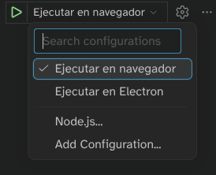

# -*- ispell-local-dictionary: "es"; encoding: utf-8; eval: (add-hook 'after-save-hook #'org-re-reveal-export-to-html nil t); compile-command: "npx vite" -*-
#+TITLE: Desarrollo de prototipos con IA
#+SUBTITLE: Máster de Videojuegos UCM
#+AUTHOR: Carlos León
#+LANGUAGE: es
# #+REVEAL_EXTRA_OPTIONS: controlsTutorial: false, controlsLayout: 'edges'
# #+REVEAL_INIT_OPTIONS: hash:true num:nil
# #+REVEAL_OPTIONS: hash:true respondToHashChanges:true history:t
 # #+OPTIONS: toc:t num:t hash:t slide-numbers:t history:t toc:nil
#+OPTIONS:  toc:nil
# num:nil
#+REVEAL_ROOT: https://cdn.jsdelivr.net/npm/reveal.js
#+REVEAL_THEME: black
#+REVEAL_TRANS: slide
#+REVEAL_SPEED: fast
# #+REVEAL_HLEVEL: 2
#+REVEAL_MARGIN: 0.02
#+REVEAL_MIN_SCALE: 0.2
# #+REVEAL_GENERATE_IDS: t
#+REVEAL_MAX_SCALE: 1.2
# #+REVEAL_SLIDE_NUMBER: c/t
# #+REVEAL_HISTORY: t
# #+REVEAL_INIT_OPTIONS: hash:true history:true slideNumbrer:true
# #+REVEAL_INIT_OPTIONS: hash:true,controls:true,progress:true,center:true,numbers:true,transition:'slide',backgroundTransition:'fade',width:1280,height:720
#+REVEAL_PLUGINS: (notes highlight search zoom)
# #+REVEAL_EXTRA_CSS: ./slides.css
# #+PROPERTY: header-args :eval never-export

* Índice

- [[Herramientas de IA (I)][Herramientas de IA (I)]]
- [[Herramientas de IA (II)][Herramientas de IA (II)]]
- [[Desarrollo en Phaser con IA (I)][Desarrollo en Phaser con IA (I)]]
- [[Desarrollo en Phaser con IA (II)][Desarrollo en Phaser con IA (II)]]
- [[Desarrollo con IA (I)][Desarrollo con IA (I)]]
- [[Desarrollo con IA (II)][Desarrollo con IA (II)]]
- [[Desarrollo con IA (III)][Desarrollo con IA (III)]]

* Herramientas de IA (I)

** Cómo funciona una IA

*** 

- ¡Hola! ¿Cómo estás?
- Muy bien, ¿y *...*
  #+ATTR_REVEAL: :frag (appear appear appear appear)
  - *...* tú?
  - *...* vosotros?
  - *...* tu hermano?
  - *...* ensalada de tomate?

*** 

#+begin_center
¿Cómo *predecimos* las siguientes palabras?
#+end_center

*** ¿Cómo *entiende* el lenguaje un ordenador?

- 8739874 18739874
- 084098091 170980470  09280948098 28 9409808 *...*
  #+ATTR_REVEAL: :frag (appear appear appear appear)
  - *...* 09802984098?
  - *...* 09820349809?
  - *...* 0917987398 98579871?
  - *...* 7138712987 581978 94 9871987?

*** 

#+begin_center
¿Cómo puede predecir un ordenador?
#+end_center

*** 
#+CAPTION: ¡Es todo *estadística*!
#+ATTR_HTML: :width 50%
[[file:2026-02-06_10-10-48_screenshot_pre.png]]

*** 

#+CAPTION: Pero le llamamos *aprendizaje máquina*
#+ATTR_HTML: :width 50%
[[file:2026-02-06_10-10-48_screenshot.png]]

*** 

#+CAPTION: Y son modelos *complejos*
#+ATTR_HTML: :width 80%
[[file:2026-02-06_10-28-58_screenshot.png]]

*** El 30 de noviembre de 2022

#+begin_center
¿Cómo se puede, con números, hacer ChatGPT?
#+end_center

*** Las ideas no son nuevas, ¿qué ha *cambiado*?

#+ATTR_REVEAL: :frag (appear appear appear)
- Capacidad de cómputo
- Modelos nuevos
- *Muchos datos*
  
  
*** Gran escala

- Varios meses de entrenamiento
- Decenas de millones de dólares
- Decenas de terabytes de información

  

*** 
#+begin_center
¿Pero por qué funciona *tan bien*?
#+end_center

***    

#+CAPTION: Arquitectura /Transformer/
#+ATTR_HTML: :width 30%
[[file:2026-02-06_11-01-55_screenshot.png]]

*** 
#+begin_center
Analiza *todas las palabras a la vez*, no una por una
#+end_center

*** 
#+begin_center
Representa las palabras como vectores de números, y lo hace analizando muchísimas frases ya escritas por personas
#+end_center

*** Ejemplos de encoding

#+begin_src python
"El perro corre" =
    [ 0.21, -0.34, 0.89, 1.12, -0.56, 0.04, ... ]
    
"El gato corre" =
   [ 0.24, -0.31, 0.85, 1.08, -0.52, 0.06, ... ]
#+end_src

*** Espacio latente = "mundo interno" donde la IA piensa

- Cada conjunto de números es un *concepto*
- Las palabras que solemos usar de forma relacionada están *cerca*

*** Generar  

#+begin_center
Con esto, ya solo nos queda *predecir*, con estadística, la próxima palabra más probable
#+end_center

*** Hasta aquí

- Tenemos mucho texto escrito por humanos (Internet)
- Analizamos las palabras y les asignamos números cercanos si las palabras aparecen relacionadas
- Cuando tenemos unas pocas palabras escritas, ya podemos predecir la siguiente, y *repetimos*

*** 

#+begin_center
ChatGPT no *sabe* nada \\
#+ATTR_REVEAL: :frag appear
No *piensa*\\
#+ATTR_REVEAL: :frag appear
No *entiende*
#+end_center

#+begin_center
#+ATTR_REVEAL: :frag appear
Solo *predice la próxima palabra más razonable*
#+end_center

*** Conclusión

- La IA moderna no es magia, ni un modelo humano: es *estadística*
- Usar cantidad casi infinita de *ejemplos* ha hecho posible que se parezca a lo que hacemos los humanos
- Hay mucha IA /diferente/ que se sigue usando
  
* Herramientas de IA (II)
** Vibe coding

* Desarrollo en Phaser con IA (I)
** Vibe coding con Phaser

*** Versiones de Phaser
- Es muy posible que el LLM tenga mucho contenido de versiones anteriores de Phaser (v2 y v3)
- Hay que saber identificar los problemas de API y corregir al modelo

** Simulación                                                         
- Tener una cuenta en GitHub
- En GitHub, ir al repositorio de la [[https://github.com/cleongh/plantillaphaser][plantilla de Phaser]]
- Pinchar en  [[file:clipboard-20261002T132319.png]]  → =Create new repository=

#+REVEAL: split
  
- Creará un repositorio nuevo con una copia de la plantilla
- Bajamos el repositorio con [[https://github.com/apps/desktop][GitHub Desktop]] (recomendado), Tortoise o línea de comandos:

#+begin_src bash
  # Atención a poner la URL de SSH si queremos hacer `push' después

  # Ejemplo:
  <cleon@fdi.ucm.es ~>$ git clone git@github.com:cleongh/mvjvibecoding.git
#+end_src

**                                                                    

[[file:clipboard-20261002T133141.png]]

** 

#+caption: Es posible ejecutar el juego en navegador, y con una ventana independiente (Electron)

**                                                                    

18:46-18:52 o por ahí

** Podéis cambiar los datos de package.json

#+begin_src json
{
    "name": "Nombre del paquete node",
    "description": "Mi juego es genial",
    "repository": {
        "type": "git",
        "url": "git+https://github.com/cleongh/MI-REPOSITORIO.git"
    },
    "author": "Yo <mi@correo.electronico>",
    "bugs": {
        "url": "https://github.com/cleongh/MI-REPOSITORIO/issues"
    },
    "homepage": "https://github.com/cleongh/MI-REPOSITORIO#readme"
}
#+end_src

** Abrir el proyecto en VSCode

** Y pedirle nos haga un "Link to the Past"                         

[[file:clipboard-20261002T184359.png]]

** Y el resultado es funcional (GPT-6 Luna)

[[file:clipboard-20261002T185612.png]]

** No es Zelda, pero

- Funciona (teclas del cursor + espacio)
- 3 bichos que nos persiguen y nos quitan vida
- Condición de victoria (coger 3 reliquias)
- Condición de pérdida (perder vida)

*Ha hecho un juego funcional en unos minutos*  

** Hacer /commit/ de Git

- Es necesario tener bien configurado el cliente de Git porque *el agente usa línea de comandos*

** /Commits/ automáticos

* Desarrollo en Phaser con IA (II)
** Vibe coding top-down y bottom-up

* Desarrollo con IA (I)
** Assets en vibe coding

* Desarrollo con IA (II)
** Documentación y QA con v

* Desarrollo con IA (III)
** Evolución y adaptación a cambios
 
