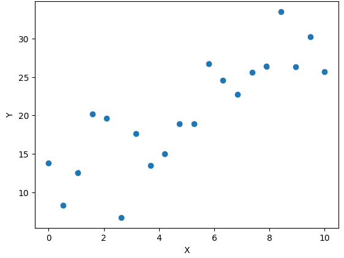
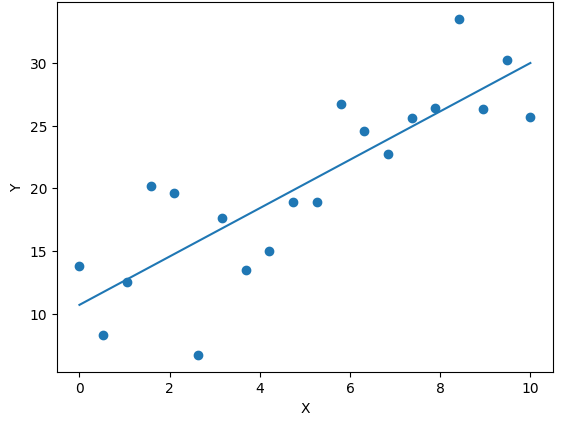
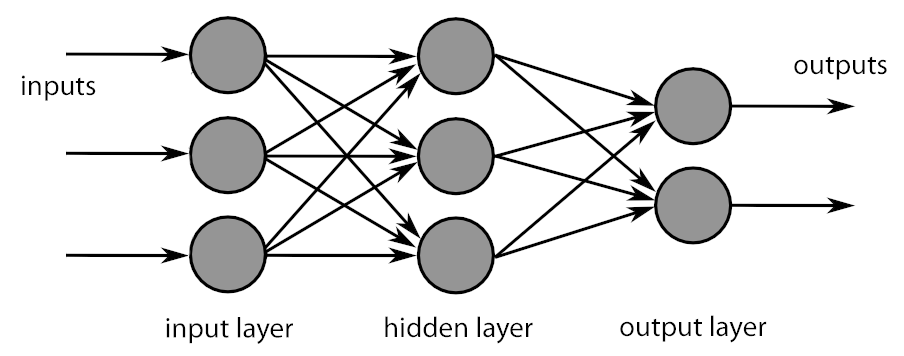
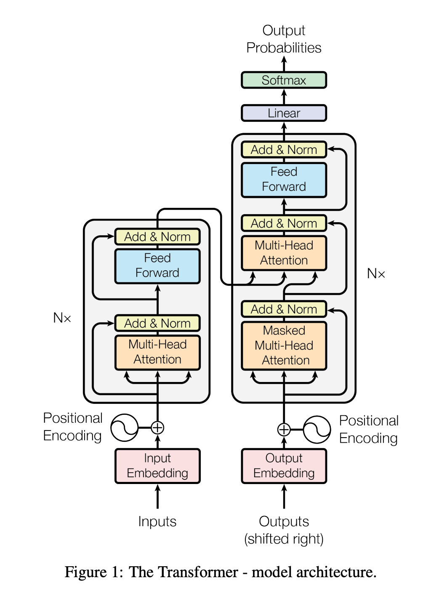
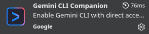
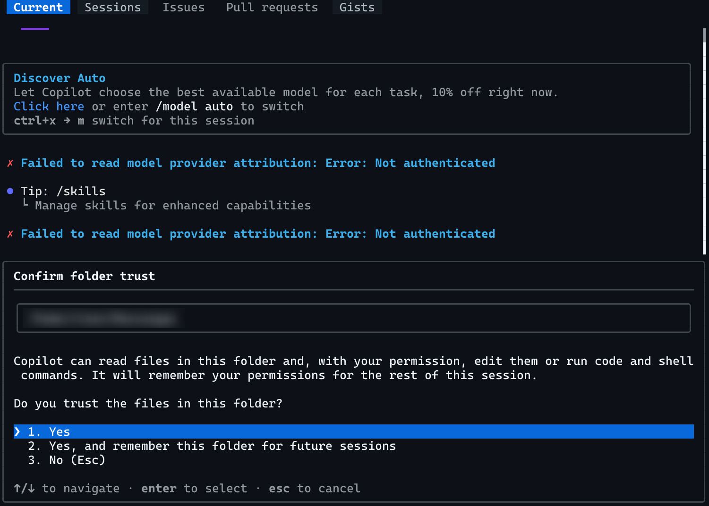
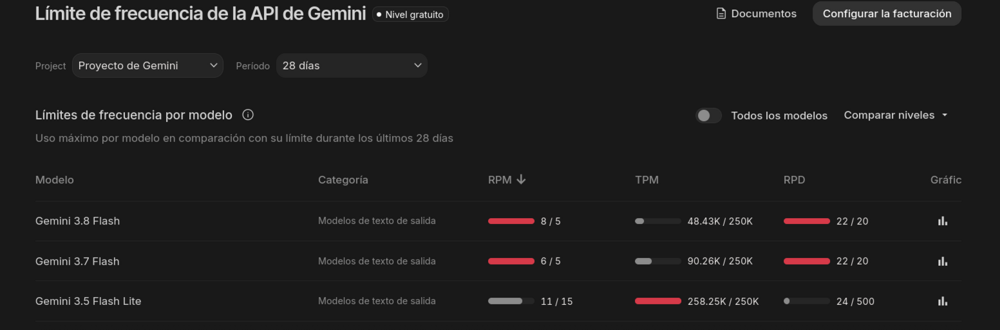

# -*- ispell-local-dictionary: "es"; encoding: utf-8; eval: (add-hook 'after-save-hook #'org-re-reveal-export-to-html nil t); compile-command: "npx vite --open" -*-
#+TITLE: Desarrollo de prototipos con IA
#+SUBTITLE: Máster de Videojuegos UCM
#+AUTHOR: Carlos León
#+email: cleon@ucm.es
#+LANGUAGE: es
#+OPTIONS:  toc:nil num:t timestamp:nil
#+REVEAL_ROOT: https://cdn.jsdelivr.net/npm/reveal.js
#+REVEAL_THEME: black
#+REVEAL_TRANS: slide
#+REVEAL_SPEED: fast
#+REVEAL_HLEVEL: 1
#+REVEAL_MARGIN: 0.02
#+REVEAL_MIN_SCALE: 0.2
#+REVEAL_GENERATE_IDS: t
#+REVEAL_MAX_SCALE: 1.2
#+REVEAL_PLUGINS: (notes highlight search zoom)
#+REVEAL_TITLE_SLIDE: <h1>%t</h1><h3>%a &lt;%e&gt;</h3><h4>%s</h4>
#+REVEAL_TITLE_SLIDE_EXTRA_ATTR: class="title-slide"
#+REVEAL_TOC_SLIDE_CLASS: toc-slide

#+BEGIN_EXPORT html

#+end_export

* Profesor
:PROPERTIES:
:UNNUMBERED: notoc
:END:

- Carlos León <[[mailto:cleon@ucm.es][cleon@ucm.es]]>
- Profesor FdI
- Docencia MVJ: Prototipado con IA, arquitectura UE, prácticas diseño de niveles, tutor de proyectos
- Investigación: Videojuegos, IA, Creatividad Computacional y Sistemas Cognitivos
- [[http://nil.fdi.ucm.es][Grupo de investigación NIL]]
- Despacho 444 FdI

* Índice
:PROPERTIES:
:UNNUMBERED: notoc
:END:

#+REVEAL_TOC: headlines 1

* Herramientas de IA (I)

** Objetivo de este módulo

#+begin_center
Poder *diseñar juegos* y probarlos sin necesidad de programar los prototipos
#+end_center

** Qué vamos a conseguir

- Entender cómo funciona una IA generativa de código
- Conocer las herramientas necesarias
- Aprender a hacer /vibe coding/
- Transformar un GDD en un juego *sin programar* (aquí vamos a "sustituir" /al programador/)
- Pulirlo y adaptarlo hasta que represente *vuestra idea*
- Poder jugar a vuestro juego en navegador, escritorio o móvil*
- Publicarlo y compartirlo fácilmente para que se pueda jugar con una URL

#+BEGIN_EXPORT html

*No lo montaremos en móvil aquí, pero se puede</small>
#+END_EXPORT

** "No quiero IA"... Hablemos

- Vamos a conocer los modelos generativos y a entenderlos
- Una formación completa hoy en día requiere que conozcáis cómo usar la IA
- Veréis muy rápido que *no sustituyen a un equipo humano*
- Pero hacer cosas para tirar en diseño con modelos generativos es una herramienta muy útil

** ¿Hasta dónde llega la IA?

La IA no va a hacer un buen juego de verdad

El reto creativo ahora es mayor: *hacer juegos que la IA no pueda hacer*

** Cómo funciona una IA

*** 

- ¡Hola! ¿Cómo estás?
- Muy bien, ¿y ...
  #+ATTR_REVEAL: :frag (appear appear appear appear)
  - ... tú?
  - ... vosotros?
  - ... tu hermano?
  - ... /ensalada de tomate/ ?

*** 

#+begin_center
¿Cómo *predecimos* las siguientes palabras?
#+end_center

*** ¿Cómo *entiende* el lenguaje un ordenador?

- 8739874 18739874
- 084098091 170980470  09280948098 28 9409808 ...
  #+ATTR_REVEAL: :frag (appear appear appear appear)
  - ... 09802984098?
  - ... 09820349809?
  - ... 0917987398 98579871?
  - ... 7138712987 581978 94 9871987?

*** 

#+begin_center
¿Cómo puede predecir un ordenador?
#+end_center

*** 
#+CAPTION: ¡Es todo *estadística*!
#+ATTR_HTML: :width 50%

*** 

#+CAPTION: Pero le llamamos *aprendizaje máquina*
#+ATTR_HTML: :width 50%

*** 

#+CAPTION: Y son modelos *complejos*
#+ATTR_HTML: :width 80%

*** El 30 de noviembre de 2022

#+begin_center
¿Cómo se puede, con números, hacer ChatGPT?
#+end_center

*** Las ideas no son nuevas, ¿qué ha *cambiado*?

#+ATTR_REVEAL: :frag (appear appear appear)
- Capacidad de cómputo
- Modelos nuevos
- *Muchos datos*
  
  
*** Gran escala

- Varios meses de entrenamiento
- Decenas de millones de dólares
- Decenas de terabytes de información

  

*** 
#+begin_center
¿Pero por qué funciona *tan bien*?
#+end_center

***    

#+CAPTION: Arquitectura /Transformer/
#+ATTR_HTML: :width 30%

*** 
#+begin_center
Analiza *todas las palabras a la vez*, no una por una
#+end_center

*** 
#+begin_center
Representa las palabras como vectores de números, y lo hace analizando muchísimas frases ya escritas por personas
#+end_center

*** Ejemplos de encoding

#+begin_src python
"El perro corre" =
    [ 0.21, -0.34, 0.89, 1.12, -0.56, 0.04, ... ]
    
"El gato corre" =
   [ 0.24, -0.31, 0.85, 1.08, -0.52, 0.06, ... ]
#+end_src

*** Espacio latente = "mundo interno" donde la IA piensa

- Cada conjunto de números es un *concepto*
- Las palabras que solemos usar de forma relacionada están *cerca*

*** Generar  

#+begin_center
Con esto, ya solo nos queda *predecir*, con estadística, la próxima palabra más probable
#+end_center

*** Hasta aquí

- Tenemos mucho texto escrito por humanos (Internet)
- Analizamos las palabras y les asignamos números cercanos si las palabras aparecen relacionadas
- Cuando tenemos unas pocas palabras escritas, ya podemos predecir la siguiente, y *repetimos*

*** 

#+begin_center
ChatGPT no *sabe* nada \\
#+ATTR_REVEAL: :frag appear
No *piensa*\\
#+ATTR_REVEAL: :frag appear
No *entiende*
#+end_center

#+begin_center
#+ATTR_REVEAL: :frag appear
Solo *predice la próxima palabra más razonable*
#+end_center

*** Conclusión

- La IA moderna no es magia, ni un modelo humano: es *estadística*
- Usar cantidad casi infinita de *ejemplos* ha hecho posible que se parezca a lo que hacemos los humanos
- Hay mucha IA /diferente/ que se sigue usando
  

** Funcionamiento y memoria en un LLM

*** ¿Qué ocurre cuando hablamos con un LLM?

#+begin_center
Prompt \\
↓ \\
Tokenización \\
↓ \\
Modelo \\
↓ \\
Predicción de tokens \\
↓ \\
Respuesta
#+end_center

*** El modelo no empieza de cero

Un LLM ya ha sido entrenado antes de que nosotros lo utilicemos

Cuando escribimos un prompt normalmente no estamos esos parámetros (no está /aprendiendo/)

*** Entonces ¿cómo parece que se acuerda?

Porque el modelo puede recibir como entrada parte de la conversación anterior (se le da "todo el histórico" en cada petición)

*** El contexto tiene un límite

El modelo no puede recibir una cantidad infinita de información

Tiene una ventana de contexto y todo lo que entra en esa ventana compite por espacio

Cuando la conversación crece el sistema puede necesitar gestionar muchísimo contexto

Dependiendo de la herramienta puede *resumir conversaciones* anteriores, *eliminar información* o utilizar otros mecanismos para mantener la conversación dentro de los límites (por eso puede *olvidar cosas*)

*** ¿El modelo aprende cuando le corrijo?

No de la misma forma que cuando entrenamos (no se llama aprendizaje en este caso)

Si decimos:

#+begin_src text
> No quiero que utilices variables globales
#+end_src

el modelo puede utilizar esa información en las siguientes respuestas si sigue presente en el contexto

Pero no estamos modificando permanentemente el modelo para que todos sus futuros usuarios sepan que no queremos Singletons

*** Adaptarse no significa reentrenarse

Un LLM puede adaptar su respuesta al contexto:

- El tono
- El nivel de detalle
- El lenguaje
- Las restricciones
- El estilo de código
- Las decisiones de implementación
- Las prioridades

Pero sus parámetros (los "números" que lo definen) no van a cambiar
  
*** ¿Entonces el modelo "entiende"?

El modelo puede representar relaciones muy complejas entre conceptos, palabras, código y estructuras

Genera texto utilizando los patrones representados en sus parámetros y el contexto disponible

*** Por eso un agente de programación es diferente

Cuando utilizamos Copilot CLI no estamos hablando solamente con un modelo

Estamos usando herramientas que dan datos adicionales al prompt aunque no lo veamos

*** El agente puede ampliar el contexto

#+begin_src text
> Arregla el bug del inventario
#+end_src

El agente puede "decidir" añadir al contexto (porque el LLM lo genera así) archivos, resultados de ejecutar herramientas, logs...

*** Esto explica el vibe coding

Podemos describir una intención

#+begin_src text
  > Quiero que el enemigo persiga al jugador pero
  vuelva a su posición inicial cuando lo pierda de vista
#+end_src

El agente puede llamar a herramientas (=ls=, =grep=, =git=), añadir su salida al contexto, y volver a generar y llamar otra vez a herramientas

*** ¿Qué ocurre cuando empezamos un chat nuevo?

Empezamos *de 0*, ya no recuerda nada del contexto

*** ¿Y si una herramienta tiene memoria?

Hay herramientas que, al iniciar una sesión de agente, meten contexto predeterminado (y parece que "te conocen mejor"), pero es solo un proceso adicional:

- Preferencias
- Información del proyecto
- Resúmenes de conversaciones
- Instrucciones
- Datos de sesiones anteriores

*** Una buena analogía

- El programador ya tiene conocimientos generales de programación → Lo que ya sabe el LLM (porque se ha entrenado con código también)
- Le damos el README y el código del proyecto → Contexto

*** Por eso el contexto es una herramienta

Un buen vibe coder no solo sabe escribir prompts, sabe decidir qué información necesita el modelo (/archivos/, /restricciones/, /errores/, /resultados/...)

  #+begin_center
Poner *de más* puede llevar al modelo a alucinar o sobregeneralizar, poner *de menos* puede hacer que falte información relevante
  #+end_center

** System prompt, usuario y contexto

El /system prompt/ contiene instrucciones que establecen el comportamiento general del modelo para esa interacción

- Qué papel debe desempeñar
- Qué tipo de respuestas debe producir
- Qué reglas debe seguir
- Qué herramientas puede utilizar
- Qué restricciones tiene
- Qué formato debe utilizar
- Qué debe evitar

*** Simplificación: sistema + usuario

- =SYSTEM=: Cómo debe comportarse. En el bajo nivel, tiene unos tokens ocultos que le dan peso sobre la respuesta (por cómo está entrenado)
- =USER=: Qué queremos conseguir (nuestro prompt en cada iteración)

(En un agente real normalmente hay muchas más piezas)

*** El contexto

El contexto es toda la información disponible para generar una respuesta:

- System prompt
- Instrucciones de la aplicación
- Mensaje del usuario (/user prompt/)
- Mensajes anteriores
- Respuestas anteriores
- Código
- Documentación
- Resultados de comandos
- ...

*** El prompt no existe aislado

Meh...

#+begin_src text
> Hazlo más rápido
#+end_src

Mejor:

#+begin_src text
> Estamos haciendo un juego 2D en Godot
El enemigo tiene actualmente 200 agentes
El cálculo de pathfinding ocurre cada frame
Hazlo más rápido
#+end_src

*** El contexto puede crecer muy rápido

Una tarea puede producir muchísima información (pregunta + sistema + tools + output...)

Cada vuelta puede añadir información

*** Los modelos tienen una ventana de contexto limitada

No podemos proporcionar indefinidamente:

- Código
- Historial
- Logs
- Documentación
- Resultados de herramientas
- Respuestas anteriores

*** La ventana de contexto

Podemos imaginarla como una caja con capacidad limitada

Todo lo que queremos que el modelo tenga disponible debe caber dentro de esa ventana

*** ¿Qué ocurre cuando se llena?

El sistema necesita gestionar el contexto

Dependiendo de la herramienta puede

- Eliminar información antigua
- Resumir mensajes anteriores
- Recuperar información relevante
- Mantener instrucciones importantes
- Crear un nuevo contexto
- *Compactar* la conversación

*** Compactar no es recordar perfectamente

El resumen es una representación de la conversación anterior que no necesariamente contiene cada detalle

El objetivo es conservar suficiente información para continuar la tarea

*** El problema de los logs

Los logs son especialmente peligrosos para el contexto

Podemos hacer:

#+begin_src text
[agente]$ npm install
#+end_src

y obtener cientos o miles de líneas

#+REVEAL: split

Pero quizá solo necesitamos

#+begin_src text
ERROR: package X requires Node 22
#+end_src

Meter todo el log en el contexto puede consumir espacio sin aportar información útil

*** Una buena sesión de agente

Podemos estructurarla

1. Definir objetivo
2. Dar restricciones
3. Investigar código relevante
4. Implementar
5. Probar
6. Corregir
7. Validar

Cada etapa debería aportar información útil al contexto

*** Cuándo empezar una sesión nueva

Puede tener sentido empezar de nuevo cuando

- Hemos cambiado completamente de tarea
- El contexto contiene demasiado ruido
- El agente ha tomado una dirección equivocada
- Hay demasiados intentos fallidos
- La conversación se ha vuelto difícil de seguir
- Queremos proporcionar un contexto más limpio

*** Pero empezar de nuevo tiene un coste

Una sesión nueva no conoce automáticamente todas las decisiones anteriores

#+REVEAL: split

Por eso podemos preparar un resumen

#+begin_src text
OBJETIVO
ESTADO ACTUAL
DECISIONES
RESTRICCIONES
ARCHIVOS IMPORTANTES
PROBLEMAS CONOCIDOS
PRÓXIMO PASO
#+end_src

Y utilizarlo como contexto inicial

*** Contexto limpio vs contexto enorme

*** El código puede ser memoria

Una de las mejores formas de conservar decisiones técnicas es escribirlas en el propio proyecto

Por ejemplo

#+begin_src text
ARCHITECTURE.md

- El inventario utiliza InventoryComponent
- No utilizamos Singleton
- Los objetos implementan IItem
- El inventario tiene 20 huecos
#+end_src

*** Instrucciones persistentes

Algunas herramientas permiten definir instrucciones específicas para un proyecto

- Convenciones de código
- Arquitectura
- Comandos
- Restricciones
- Estilo
- Reglas del proyecto

*** La memoria ideal para un proyecto

Podemos imaginar varias capas

 #+begin_center
 REGLAS DEL PROYECTO \\
         ↓ \\
   DOCUMENTACIÓN \\
         ↓ \\
      CÓDIGO \\
         ↓ \\
CONTEXTO DE LA SESIÓN \\
         ↓ \\
   PROMPT ACTUAL
 #+end_center

Cada capa aporta información diferente

*** ¿Qué debería ir en cada capa?

Es positivo usar Markdown:

#+begin_src markdown
# REGLAS

"Usamos C#"
"No usamos Singleton"

# DOCUMENTACIÓN

"El sistema de inventario funciona así"

# CÓDIGO

Implementación real

# SESIÓN

"Ahora estamos arreglando RemoveItem()"

# PROMPT

"Corrige este error"
#+end_src

*** Contexto y coste

Más tokens de entrada pueden significar

- Más procesamiento
- Mayor consumo
- Mayor coste en sistemas basados en tokens
- Menos espacio disponible para la respuesta

Por eso gestionar el contexto es también una cuestión de eficiencia

*** Para vibe coding

- Compactar (=/compact=)
- Empezar una sesión nueva
- Recuperar documentación
- Reducir el contexto
- Dar de nuevo las restricciones importantes

** Herramientas de IA para generar

*** Webs con chat

- [[https://chatgpt.com/][ChatGPT]]
- [[https://claude.ai/][Claude]]
- [[https://gemini.google.com/][Gemini]]
- [[https://copilot.microsoft.com/][Microsoft Copilot]]
- [[https://www.perplexity.ai/][Perplexity]]
- [[https://grok.com/][Grok]]
- [[https://chat.mistral.ai/][Le Chat]]

*** Agentes de código

- [[https://claude.ai/code][Claude Code]]
- [[https://cursor.com/][Cursor]]
- [[https://openai.com/codex/][Codex]]
- [[https://github.com/features/copilot][GitHub Copilot]]
- [[https://antigravity.google/][Google Antigravity]]
- [[https://cline.bot/][Cline]]
- [[https://aider.chat/][Aider]]
- [[https://devin.ai/][Devin]]
 
*** Herramientas de completado

- [[https://github.com/features/copilot][GitHub Copilot]]
- [[https://cursor.com/][Cursor]]
- [[https://aws.amazon.com/codewhisperer/][Amazon Q Developer]]
- [[https://developers.google.com/gemini-code-assist][Gemini Code Assist]]
- [[https://devin.ai/desktop][Devin Desktop]]

*** Modelos generativos integrados de juegos

- [[https://labs.google/playground][Google Playground]]
- [[https://rosebud.ai/][Rosebud AI]]
- [[https://gdevelop.io/][GDevelop AI]]
- [[https://replit.com/usecases/ai-game-builder][Replit Game Builder]]
- [[https://www.summerengine.com/][Summer Engine]]
- [[https://phaser.io/][Phaser Game Agent]]
- [[https://create.roblox.com/docs/assistant/guide][Roblox Assistant]]
- [[https://www.buildbox.ai/][Buildbox]]

*** Visual Studio Code

Usaremos [[https://code.visualstudio.com/][VSCode]] y su integración con agentes

- Las últimas versiones vienen con Copilot ya integrado (con la cuenta de GitHub student lo tenéis)
- Antes se podía usar Gemini instalando su extensión:

(pero ahora hay que usar [[https://antigravity.google/][Antigravity]])

** Cuentas UCM para usar modelos

*** 

La cuenta de la UCM proporciona un cuenta da acceso a [[https://workspace.google.com/intl/es/?hl=es][Google Workspace]] y [[https://ssii.ucm.es/office-365-proplus-para-la-comunidad-universitaria-complutense][Microsoft 365]]: *tuusuario@ucm.es*

#+BEGIN_EXPORT html
<small style="display:block; margin-top:2em; color:#999;">
La disponibilidad concreta de cada servicio puede depender de la licencia
y de la configuración institucional
</small>
#+END_EXPORT

*** Microsoft Copilot 365

En [[https://portal.office.com/account][Microsoft 365 · Mi cuenta]] → ~Suscripciones~ puedes ver que tienes acceso a Copilot

Un vez ahí, entra en [[https://m365.cloud.microsoft/chat/?es=SSR][Copilot 365]] (integrado con los servicios de Office 365).

*** GitHub Copilot CLI

Si no tienes una cuenta de GitHub, [[https://github.com/signup][créala]]

Usa la dirección *tuusuario@ucm.es* para que sea de estudiante

*** Verifica que eres estudiante

Entra en:

[[https://github.com/settings/education/benefits][GitHub Education · Benefits]]

Pulsa en *=Start an application=*

Completa la verificación como estudiante.

Los estudiantes verificados obtienen acceso gratuito a
*GitHub Copilot Student*

*** Instala Copilot CLI

Necesitas [[https://nodejs.org/es][Node.js]]:

#+BEGIN_SRC sh
[usuario$/]$ npm install -g @github/copilot
#+END_SRC

o, si no tienes permisos de escritura como administrador (sin =-g=):

#+BEGIN_SRC sh
  [usuario$/proyecto/]$ npm init --yes
  [usuario$/proyecto]$ npm install @github/copilot
#+END_SRC

#+REVEAL: split

Después:

#+BEGIN_SRC sh
[usuario$/proyecto]$ copilot
#+END_SRC

Dentro de Copilot CLI, inicia sesión:

#+BEGIN_SRC text
/login
#+END_SRC

*** 

#+CAPTION: Copilot CLI
#+ATTR_HTML: :width 80%

*** Google Antigravity

Para usar los modelos de Google, hay que usar [[https://antigravity.google/][Google Antigravity]]

Hay que:

1. Bajarlo
2. Usar una cuenta personal (la UCM aún no da permisos)

*** 
Por dentro, Antigravity tiene el mismo editor que VSCode 
   

*** Devin

https://devin.ai/

*** Google AI Studio

https://aistudio.google.com/

*** ¿Qué modelo uso?

- *TODOS*
- Es posible mezclarlos, sacar lo mejor de cada uno
- Lo mejor para prototipar es usar los modelos más fuertes (y más "caros") primero para que la base de código sea robusta y hacer que modelos más baratos retoquen cosas

** Tokens, cuotas y costes

https://aistudio.google.com/rate-limit

#+CAPTION: Gestión de tokens en AI Studio de Google
#+ATTR_HTML: :width 50%

** llamafiles

Es posible ejecutar modelos de lenguaje en local (sin necesidad de usar un servicio externo)

Hay varias formas, una muy sencilla es con [[https://github.com/mozilla-ai/llamafile][llamafiles]]

Y hay [[https://docs.mozilla.ai/llamafile/getting-started/pre-built-llamafiles][muchos modelos]] disponibles

** Tareas

#+begin_center
Generar una aventura conversacional tipo Zork (con Gemini Antigravity, por ejemplo) sin tocar código
#+end_center

#+REVEAL: split

- Asegurarse de tener Node.js y un modelo (Copilot, Gemini...)
- Pedirle al modelo desde terminal que nos genere una aventura gráfica en modo texto en JavaScript y Node.js
- No vamos a "generar → salir → ejecutar → repetir", sino que vamos a hacerlo todo desde línea de comandos, incluso /ejecutar/ el juego
- Cuidado con los tokens, los costes, el modelo que usamos...
- Vamos generando versiones, comprobando código, revisando... un /diálogo/ con el sistema
  
* Herramientas de IA (II)
* Desarrollo en Phaser con IA (I)
* Desarrollo en Phaser con IA (II)
* Desarrollo con IA (I)
* Desarrollo con IA (II)
* Desarrollo con IA (III)
